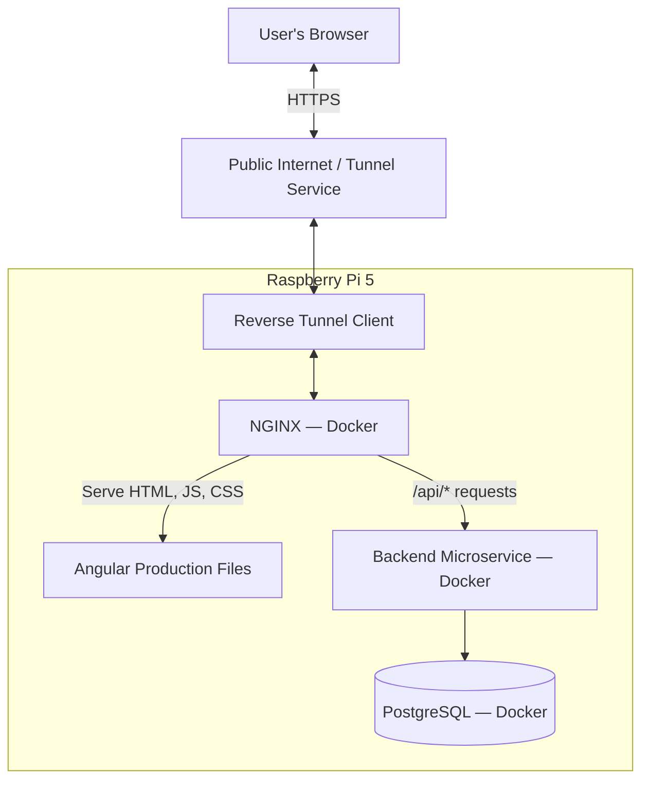
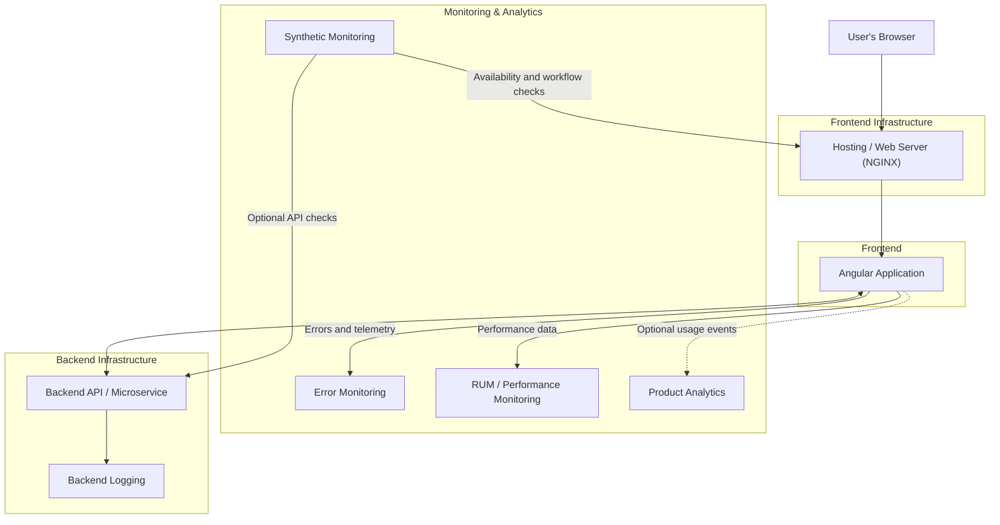

# What other components FE should have

- Excluding source code components

## Components

⚠️ Investigate exact pipeline for each component prior to implementation

- **Hosting & Delivery** (nginx — Docker)
- **Frontend Error monitoring** 
   - tool Grafana Faro Web SDK --> in browser (collector errors & RUM)
   - tool Grafana Alloy --> Docker container (recieves telemetry)
   - tool Loki (logs) + Tempo (traces) --> Docker container (collects and stores logs and traces)
   - tool Grafana --> Docker container (visualizes metrics, logs, and traces)
- **Real User Monitoring (RUM)**
   - tool Grafana Faro Web SDK --> in browser (collector errors & RUM)
   - tool Grafana Alloy --> Docker container (recieves telemetry)
   - tool Loki (logs) + Tempo (traces) --> Docker container (collects and stores logs and traces)
   - tool Grafana --> Docker container (visualizes metrics and logs)
- **Synthetic Monitoring**
   - tool Prometheus Blackbox Exporter --> Docker container (Checks HTTP/HTTPS endpoints, response times, DNS, and TCP connectivity)
   - tool Grafana --> Docker container 'existing' (visualizes synthetic monitoring results)
   - Grafana Alertmanager --> Docker container 'existing' (handles alerts based on synthetic monitoring results)
- **Security Controls**
   - HTTPS (Traffic interception and tampering in transit) --> Docker container 'existing' NGINX
   - HTTP security headers (Certain browser-based attacks) --> Docker container 'existing' NGINX
   - Certbot (Obtains and renews TLS certificates) --> Docker container
   - Authentication and authorization --> Docker container backend service
   - Request protection (Malformed or abusive requests) --> Docker container 'existing' NGINX
   - Network and host security (Unnecessary exposure of services) --> host system hardening
   - Secrets management (Exposure of credentials) --> Docker container HashiCorp Vault
   - Container security (Vulnerabilities within container images) --> CI to scan container images and dependencies prior to deployment with tools like `Trivy`
- **Dependency and vulnerability scanning** --> CI npm audit, Github Dependabot, CI Trivy
- **Analytics** (Depends on business needs). Select the tool based on needs 
   - tool Plausible Analytics --> Docker container (collects and visualizes product analytics)
   - tool Google Analytics --> External service (collects and visualizes product analytics)

**Chart L0**


**Chart L1**


---

# Observability and Monitoring

## Pipelines:
### 1. Frontend telemetry

- **Logs, errors, and frontend events**: Browser (Faro Web SDK) → Alloy → Loki → Grafana. Frontend logs, exceptions, Web Vitals records, and other telemetry events are collected and stored as logs in Loki.

- **Distributed traces**: Browser (Faro Web SDK + Faro Web Tracing) → Alloy → Tempo → Grafana. Browser-generated traces, including instrumented HTTP requests, are collected and stored in Tempo.

- **Observability infrastructure metrics**: Alloy → Prometheus → Grafana. Prometheus scrapes Alloy's exposed metrics, including Faro receiver counters for received events, logs, exceptions, and measurements.

- **Web Vitals metrics**: LCP, INP, and CLS measurements are currently collected as frontend telemetry records in Loki. A separate pipeline to export these individual measurements as Prometheus time series is not currently configured.

    ```
    Browser
    │
    ▼
    Grafana Faro Web SDK
    │
    ▼
    Grafana Alloy
    ├── Logs, errors, events, and Web Vitals records
    │       └──► Loki ──► Grafana
    │
    └── Traces
            └──► Tempo ──► Grafana

    Grafana Alloy ──► Prometheus ──► Grafana
                    (receiver and
                    infrastructure metrics)`
    ```

### 2. Backend telemetry
- Backend instrumentation → Alloy → Loki → Grafana — application logs.
- Backend instrumentation → Alloy → Tempo → Grafana — distributed traces.
- Backend metrics → Prometheus → Grafana — application metrics, if Prometheus is your chosen metrics backend.
### 3. Database telemetry
- PostgreSQL logs → Alloy → Loki → Grafana — database logs.
- Backend database instrumentation → Alloy → Tempo → Grafana — database-operation spans within distributed traces.
- PostgreSQL exporter → Prometheus → Grafana — database performance metrics.

---

An overview of possible frontend telemetry and its actual implementation in the current setup.

## 1. Errors

Errors and exceptions occurring in the browser or application.

| Sub-category | What to test | Expected source | Priority | Part of Setup | Test link | Integration Test | CI Test |
|---|---|---|---|---|---| --- |----|
| Uncaught JavaScript exceptions | Uncaught exception, e.g., `throw new Error(...)` | `ErrorsInstrumentation` | Required | Yes | [Test-001](#test-001) | [Test-001](#test-001) | [test_001_uncaught_exception.py](../../../scripts/ci/observability-fe/errors/test_001_uncaught_exception.py)
| Unhandled promise rejections | Rejected Promise without its own handler | `ErrorsInstrumentation`, if the event bubbles up to a registered handler | Required | Yes | [Test-002](#test-002) | [Test-002](#test-002) | [test_002_unhandled_promise_rejections.py](../../../scripts/ci/observability-fe/errors/test_002_unhandled_promise_rejections.py)
| Console errors | Calls to `console.error(...)` | `ConsoleInstrumentation` | Recommended | Yes | [Test-003](#test-003) | [Test-003](#test-003) | [test_003_cosole_errors.py](../../../scripts/ci/observability-fe/errors/test_003_cosole_errors.py)
| Angular runtime errors | Error caught by Angular error handler | Typically Angular error handler → console; depends on handling method | Required | Yes | [Test-004](#test-004) | [Test-004](#test-004) | [test_004_angular_runtime_errors.py](../../../scripts/ci/observability-fe/errors/test_004_angular_runtime_errors.py)
| Type errors | For example, calling a method on `undefined` | `ErrorsInstrumentation`, if the exception remains unhandled | Required | Yes | [Test-005](#test-005) | [Test-001](#test-001) | [test_005_type_errors](../../../scripts/ci/observability-fe/errors/test_005_type_errors.py)
| Reference errors | Accessing a non-existent variable | `ErrorsInstrumentation`, if the exception remains unhandled | Required | Yes | [Test-006](#test-006) | [Test-001](#test-001) | [test_006_reference_errors.py](../../../scripts/ci/observability-fe/errors/test_006_reference_errors.py)
| Resource loading errors | Failure to load an image, script, or other resource | Depends on the type of resource and instrumentation | Recommended | Yes | [Test-007](#test-007) | [Test-007](#test-007) | [test_007_resource_loading_errors.py](../../../scripts/ci/observability-fe/errors/test_007_resource_loading_errors.py)
| Errors with stack traces | Errors containing stack trace | Part of captured errors, if available | Required | Yes | [Test-008](#test-008) | [Test-001](#test-001) | [test_008_errors_with_stack_trace](../../../scripts/ci/observability-fe/errors/test_008_errors_with_stack_trace.py)
| Content Security Policy violations | Violation of CSP rules | `CSPInstrumentation`, if active and the browser provides the event | Recommended | Yes | [Test-009](#test-009) | [Test-009](#test-009) | [test_009_csp_violation.py](../../../scripts/ci/observability-fe/errors/test_009_csp_violation.py)
| Repeated errors | Repetition of the same error | The same error as reported | Recommended | Yes | [Test-010](#test-010) | [Test-010](#test-010) | [test_010_repeated_error.py](../../../scripts/ci/observability-fe/errors/test_010_repeated_error.py)
| Faro Duplication | 	Faro SDK deduplication behaviour in isolation | Verify SDK behavior and subsequent aggregation | Required | Yes | [Test-010A](#test-010a) | [Test-010A](#test-010a) | [test_010a_faro_sdk_deduplication.py](../../../scripts/ci/observability-fe/errors/test_010a_faro_sdk_deduplication.py)


## 2. Network

| Sub-category | What to test | Expected source | Priority | Part of Setup | Test link | Integration Test | CI Test |
|---|---|---|---|---|---| --- |---|
| Successful HTTP requests | HTTP 200 | Verify that requests are captured | Required | Yes | [Test-011](#test-011) | [Test-011](#test-011) | [test_011_successfull_http_request](../../../scripts/ci/observability-fe/network/test_011_successfull_http_request.py)
| Client errors | HTTP 400, 404 | HTTP error does not automatically mean Faro error | Required | Yes | [Test-012](#test-012) | [Test-012](#test-012) | [test_012_client_http_errors.py](../../../scripts/ci/observability-fe/network/test_012_client_http_errors.py)
| Server errors | HTTP 500 | Verify request capture and any errors | Required  | Yes | [Test-013](#test-013) | [Test-013](#test-013) | [test_013_server_http_error](../../../scripts/ci/observability-fe/network/test_013_server_http_error.py)
| Network failures | Unavailable server, interrupted connection | Depends on instrumentation | Required | TBD | [Test-014](#test-014) |[Test-014](#test-014) | [test_014_netwrok_failures.py](../../../scripts/ci/observability-fe/network/test_014_netwrok_failures.py)
| Request timeout | Timeout expiration | Depends on implementation | Recommended | TBD | TBD | [Test-014](#test-014) | [test_014_netwrok_failures.py](../../../scripts/ci/observability-fe/network/test_014_netwrok_failures.py)
| Fetch API | Requests via `fetch()` | Verify default support | Required | -- | -- | [Test-011](#test-011) | [test_011_successfull_http_request.py](../../../scripts/ci/observability-fe/network/test_011_successfull_http_request.py)
| XMLHttpRequest | Requests via XHR | Verify default support | Required | TBD | TBD| [Test-011](#test-011) | [test_011_successfull_http_request.py](../../../scripts/ci/observability-fe/network/test_011_successfull_http_request.py)
| Request duration | Re quest duration | Depends on instrumentation | Required | TBD | TBD | [Test-011](#test-011) | [test_011_successfull_http_request.py](../../../scripts/ci/observability-fe/network/test_011_successfull_http_request.py)
| Request metadata | URL, method, and response status | Verify what data is recorded | Required | TBD | TBD | [Test-011](#test-011) | [test_011_successfull_http_request.py](../../../scripts/ci/observability-fe/network/test_011_successfull_http_request.py)
| CORS failures | CORS errors | Browser may hide some details | Recommended | TBD | TBD | [Test-014](#test-014) | [test_014_netwrok_failures.py](../../../scripts/ci/observability-fe/network/test_014_netwrok_failures.py)

## 3. Logs

| Sub-category | What to test | Expected source | Priority | Part of Setup | Test link | Integration Test | CI Test |
|---|---|---| --- | --- | ---- | ---- |---|
| `console.debug()` | Debug message | `ConsoleInstrumentation` | Recommended | -- | -- | [Test-021](#test-021) | [test_021_browser_console_log_capture.py](../../../scripts/ci/observability-fe/logs/test_021_browser_console_log_capture.py) 
| `console.info()` | Informational message | `ConsoleInstrumentation` | Recommended | -- | -- | [Test-021](#test-021) |  [test_021_browser_console_log_capture.py](../../../scripts/ci/observability-fe/logs/test_021_browser_console_log_capture.py) |
| `console.log()` | Regular message | `ConsoleInstrumentation` | Recommended | -- | -- | [Test-021](#test-021) |  [test_021_browser_console_log_capture.py](../../../scripts/ci/observability-fe/logs/test_021_browser_console_log_capture.py) |
| `console.warn()` | Warning | `ConsoleInstrumentation` | Required | -- | -- | [Test-021](#test-021) |  [test_021_browser_console_log_capture.py](../../../scripts/ci/observability-fe/logs/test_021_browser_console_log_capture.py) |
| `console.error()` | Error message | `ConsoleInstrumentation` | Required | -- | -- | [Test-021](#test-021) |  [test_021_browser_console_log_capture.py](../../../scripts/ci/observability-fe/logs/test_021_browser_console_log_capture.py) |
| Custom application logs | Logs generated by the application via Faro API | Faro API | Required | -- | -- | [Test-022](#test-022) | [test_022_custom_application_logs_development.py](../../../scripts/ci/observability-fe/logs/test_022_custom_application_logs_development.py)
| Log message context | Context and metadata of the message | Faro API / instrumentation | Required | -- | -- | [Test-022](#test-022) | [test_022_custom_application_logs_development.py](../../../scripts/ci/observability-fe/logs/test_022_custom_application_logs_development.py)
| Log severity / level | Message level and its mapping | Faro → Alloy → Loki |  Required | -- | -- | [Test-022](#test-022) | [test_022_custom_application_logs_development.py](../../../scripts/ci/observability-fe/logs/test_022_custom_application_logs_development.py)
| Log filtering | Which messages the SDK ignores or filters | SDK configuration |  Recommended | -- | -- | [Test-023](#test-023) | [test_023_custom_application_logs_production.py](../../../scripts/ci/observability-fe/logs/test_023_custom_application_logs_production.py)

## 4. Performance Monitoring

Faro has PerformanceInstrumentation enabled by default, unless it is disabled in the configuration.

| Sub-category | What to test | Expected source |Priority | Part of Setup | Test link | Integration Test | CI Test
|---|---|---|---| ---| --- | --- | --- |
| Page load timing | Page load time | Performance API | Required | -- | -- | [Test-030](#test-030) | [test_030_page_load_navigation_timing.py](../../../scripts/ci/observability-fe/performance/test_030_page_load_navigation_timing.py)
| Navigation timing | Navigation timing data | Performance API | Required | -- | -- | [Test-030](#test-030) | [test_030_page_load_navigation_timing.py](../../../scripts/ci/observability-fe/performance/test_030_page_load_navigation_timing.py)
| Resource timing | Resource load timing data | Performance API | Required | -- | -- | [Test-031](#test-031) | [test_031_web_vitals.py](../../../scripts/ci/observability-fe/performance/test_031_web_vitals.py) 
| Long tasks | Long tasks blocking the main thread, if supported by the SDK/browser | Performance API |  Recommended | -- | -- | [Test-031](#test-031) | [test_031_web_vitals.py](../../../scripts/ci/observability-fe/performance/test_031_web_vitals.py)
| Web Vitals — LCP | Largest Contentful Paint | `WebVitalsInstrumentation` | Required |  -- | -- | [Test-031](#test-031) | [test_031_web_vitals.py](../../../scripts/ci/observability-fe/performance/test_031_web_vitals.py)
| Web Vitals — CLS | Cumulative Layout Shift | `WebVitalsInstrumentation` | Required |  -- | -- | [Test-031](#test-031) | [test_031_web_vitals.py](../../../scripts/ci/observability-fe/performance/test_031_web_vitals.py)
| Web Vitals — INP | Interaction to Next Paint | `WebVitalsInstrumentation` | Required |  -- | -- | [Test-031](#test-031) | [test_031_web_vitals.py](../../../scripts/ci/observability-fe/performance/test_031_web_vitals.py)
| Web Vitals — FCP | First Contentful Paint | `WebVitalsInstrumentation` |  Recommended |  -- | -- | [Test-031](#test-031) | [test_031_web_vitals.py](../../../scripts/ci/observability-fe/performance/test_031_web_vitals.py)
| Web Vitals — TTFB | Time to First Byte | `WebVitalsInstrumentation` |  Recommended |  -- | -- | [Test-031](#test-031) | [test_031_web_vitals.py](../../../scripts/ci/observability-fe/performance/test_031_web_vitals.py)
| User interactions | Clicks and other user actions according to instrumentation |   `UserActionInstrumentation` |   Recommended |  -- | -- | [Test-032](#test-032) | [test_032_user_interaction.py](../../../scripts/ci/observability-fe/performance/test_032_user_interaction.py)
| Performance measurements | Custom measurements via the Performance API | Depends on instrumentation and configuration |   Recommended | -- | -- | [Test-033](#test-033) | [test_033_custom_performance_measurement.py](../../../scripts/ci/observability-fe/performance/test_033_custom_performance_measurement.py)

## 5. Host performance

**Mostly not applicable to frontend observability**. These are infrastructure and backend monitoring capabilities, not telemetry generated by Angular application.

| Subcategory | Examples | Typical collection method | Priority | Part of Setup | Test link | Integration Test |
|---|---|---|---|---|---|---|
| CPU | Utilization, load average | Node Exporter or host metrics agent | Optional | -- | -- | No |
| Memory | Total, used, available, swap | Node Exporter | Optional | -- | -- | No |
| Disk capacity | Free space, filesystem utilization | Node Exporter | Optional | -- | -- | No |
| Disk I/O | Read/write throughput, latency | Node Exporter | Optional | -- | -- | No |
| Network | Throughput, errors, dropped packets | Node Exporter | Optional | -- | -- | No |
| System health | Uptime, load, resource pressure | Host metrics exporter | Optional | -- | -- | No |
| Temperature | CPU/SoC temperature | Raspberry Pi-specific system metrics collector | Optional | -- | -- | No |
| Processes | Process counts and resource usage | Host monitoring tools | Optional | -- | -- | No |
| Docker containers | CPU, memory, restarts, health | cAdvisor or suitable container metrics collection | Optional | -- | -- | No |
| NGINX | Requests, response codes, connections, latency | NGINX metrics exporter or supported integration | Optional | -- | -- | No |
| Backend application | Request rate, errors, latency | Application instrumentation or metrics endpoint | Optional | -- | -- | No |
| PostgreSQL | Connections, transactions, query performance | PostgreSQL exporter | Optional | -- | -- | No |
| Reverse tunnel | Connectivity, availability, reconnects | Tunnel-specific monitoring or external health checks | Optional | -- | -- | No |

## 6. Navigation & Session

| Sub-category | What to test | Expected source | Priority | Part of Setup | Test link | Integration Test | CI Test |
|---|---|---|--- | ---- |---|---|---|
| Page views / views | Observation of page or view | `ViewInstrumentation` | Required | -- | -- | [Test-040](#test-040) | [test_040_page_views_views.py](../../../scripts/ci/observability-fe/navigation_session/test_040_page_views_views.py)
| Route changes | Navigation between Angular routes | Depends on configuration and integration | Required | -- | -- | [Test-040](#test-040) | [test_040_page_views_views.py](../../../scripts/ci/observability-fe/navigation_session/test_040_page_views_views.py)
| Browser navigation | Browser navigation | `NavigationInstrumentation`, according to settings | Recommended | -- | -- | [Test-041](#test-041) | 
| Session information | Session information | `SessionInstrumentation` | Required | -- | -- | [Test-043](#test-043) |
| User actions | User actions | `UserActionInstrumentation` | Recommended |  -- | -- | [Test-032](#test-032) | [test_032_user_interaction.py](../../../scripts/ci/observability-fe/performance/test_032_user_interaction.py)
| Session correlation | Correlation of events with the session | Faro metadata | Required |  -- | -- | [Test-043](#test-043) |
| App identity | Application name and version | Configuration `app` | Required |  -- | -- | [Test-043](#test-043) |

## 7. Traces

| Sub-category | What to test | Note | Priority | Part of Setup | Test link | Integration Test |
|---|---|---| --- |---|---|---|
| Frontend spans | Individual operations in the browser | Requires supported tracing instrumentation | Required | -- | -- | [Test-047](#test-047) |
| HTTP client spans | Frontend HTTP requests represented as spans | Verify Faro SDK support and configuration |  Required | -- | -- | [Test-048](#test-048) |
| Trace IDs | Unique identifier for an entire trace | Generated or propagated by tracing instrumentation | Required | -- | -- | [Test-047](#test-047) |
| Span IDs | Unique identifier for an individual span | Generated by tracing instrumentation |  Required | -- | -- | [Test-047](#test-047) |
| Parent-child span relationships | Correct relationships between related operations | Verify parent and child span context |  Required | -- | -- | [Test-048](#test-048) |
| Trace propagation | Passing trace context over HTTP | Requires compatible instrumentation, headers, and CORS configuration |  Required | -- | -- | [Test-049](#test-049) |
| Backend spans | Backend operations represented as spans | Requires backend tracing instrumentation |  Recommended | -- | -- | [Test-053](#test-053) |
| Database spans | Database queries and operations represented as spans | Requires backend/database client instrumentation |  Optional | -- | -- | [Test-053](#test-053) |
| End-to-end traces | Linking browser → backend → database | Requires instrumentation and context propagation across components |  Required | -- | -- | [Test-053](#test-053) |
| Span attributes | HTTP method, route, status code, service name, and other relevant metadata | Verify which attributes are recorded |   Required | -- | -- | [Test-047](#test-047) |
| Span events | Events recorded within a span | Requires instrumentation that emits span events |   Recommended | -- | -- | [Test-048](#test-048) |
| Error recording | Exceptions, error status, and relevant details on spans | Depends on instrumentation and error handling | Required | -- | -- | [Test-048](#test-048) |
| Trace sampling | Whether traces are recorded or discarded | Depends on SDK and collector configuration |    Recommended | -- | -- | [Test-059](#test-059) |
| Tempo ingestion | Confirm Alloy successfully forwards traces to Tempo | Verify receiver/exporter configuration and Tempo availability |  Required | -- | -- | [Test-060](#test-060) |
| Trace querying | Search for traces in Grafana | Requires a working Tempo data source |  Required | -- | -- | [Test-060](#test-060) |
| Trace-to-logs correlation | Navigate from a trace to related logs | Requires compatible trace IDs and log metadata |   Recommended | -- | -- | [Test-062](#test-062) |
| Trace-to-metrics correlation | Navigate between traces and relevant metrics | Requires appropriate metric labels and Grafana configuration | Optional | -- | -- | [Test-062](#test-062) |
| Trace retention | Verify how long traces remain available | Depends on Tempo storage and retention configuration |   Recommended | -- | -- | [Test-060](#test-060) |
| Pipeline resilience | Behavior when Alloy or Tempo is unavailable | Verify buffering, retries, and recovery behavior where supported |   Recommended | -- | -- | [Test-060](#test-060) |

## 8. Metrics

| Sub-category | What to test | Note | Priority | Part of Setup | Test link | Integration Test |
|---|---|---|---|---|---|---|
| Web Vitals | LCP, CLS, INP and other supported metrics | Can be sent as Faro events | Required | -- | -- | [Test-066](#test-066) |
| Page performance | Page load times | Depends on instrumentation | Required |  -- | -- | [Test-067](#test-067) |
| Resource performance | Resource load times | Depends on instrumentation | Required |  -- | -- | [Test-067](#test-067) |
| Custom measurements | Custom numeric values | Require appropriate API/instrumentation | Recommended |  -- | -- | [Test-069](#test-069) |
| Application counters | Counts of clicks, errors, or operations | Usually require custom implementation | Recommended |  -- | -- | [Test-069](#test-069) |
| Backend metrics | CPU, memory, request rate, latency | Requires backend monitoring | Optional | No | No | Outside frontend scope |
| Infrastructure metrics | CPU/RAM Raspberry Pi, Docker, and others | Requires system instrumentation | Optional | No | No | Outside frontend scope |

## 9. User Actions

| Sub-category | What to test |  Note | Priority | Part of Setup | Test link | Integration Test |
|---|---|---|----|----|----|----|             
| Clicks | Clicks on buttons and elements | -- | Recommended | -- | -- | [Test-071](#test-071) |
| User input interactions | Interactions with forms | -- | Recommended | -- | -- | [Test-071](#test-071) |
| Action names | How events are named | -- | Required | -- | -- | [Test-073](#test-073) 
| Action context | Context of the interaction | -- | Required | -- | -- | [Test-073](#test-073) 
| Navigation after interaction | Interaction leading to navigation |  -- | Recommended | -- | -- | [Test-075](#test-075) 
| Error after interaction | Error occurring after interaction | -- | Required | -- | -- | [Test-076](#test-076) 
| Action duration | Duration of an interaction or operation |  -- | Optional | -- | -- | [Test-073](#test-073) 
| User identification / session association | Association of actions with session and available user context |  -- | Required | -- | -- | [Test-073](#test-073) 

## 10. Security & browser diagnostics

| Sub-category | What to test |  Note | Priority | Part of Setup | Test link | Integration Test |
|---|---|---|---|---|---|---|
| Content Security Policy | CSP violations reported by the browser | -- | Recommended | -- | -- | [Test-009](#test-009) |
| Blocked resources | Resources blocked by CSP or browser restrictions | -- | Recommended | -- | -- | [Test-080](#test-080) |
| CORS diagnostics | Incorrect CORS configuration and resulting failures | -- | Recommended | -- | -- | [Test-014](#test-014) |
| Browser restrictions | Browser restrictions affecting telemetry collection or submission | -- | Required | -- | -- | [Test-082](#test-082) |
| Payload size limits | Rejection or handling of oversized telemetry payloads | -- | Recommended | -- | -- | [Test-083](#test-083) |
| Receiver rate limiting | Handling of requests exceeding Alloy receiver limits | -- | Recommended | -- | -- | [Test-083](#test-083) |
| Invalid telemetry payloads | Handling of malformed telemetry payloads | -- | Recommended | -- | -- | [Test-083](#test-083) |
| Sensitive data protection | Preventing passwords, tokens and personal data from entering telemetry | -- | Required | -- | -- | [Test-086](#test-086) |
| Telemetry transport security | HTTPS and secure transmission of telemetry | -- | Reuired | -- | -- | [Test-082](#test-082) |

## 11. Telemetry Pipeline & Delivery

| Sub-category | What to test | Note | Priority | Part of Setup | Test link | Integration Test |
|---|---|---|---|---|---|---|
| Faro initialization | SDK initializes | -- | Required | -- | -- | [Test-088](#test-088) 
| Telemetry submission | Browser sends requests to Alloy | -- | Required | -- | -- | [Test-089](#test-089) 
| CORS | Alloy accepts requests from Angular origin |  -- | Required | -- | -- | [Test-089](#test-089) 
| Receiver availability | Alloy receiver is available |  -- | Required | -- | -- | [Test-091](#test-091) 
| Payload acceptance | Alloy accepts telemetry |  -- | Required | -- | -- | [Test-091](#test-091) 
| Loki ingestion | Logs arrive in Loki |  -- | Required | -- | -- | [Test-093](#test-093) 
| Label mapping | Correct Loki labels |  -- | Required | -- | -- | [Test-093](#test-093)
| Log content | Correct log content |  -- | Required | -- | -- | [Test-093](#test-093)
| Grafana queries | Data can be found using LogQL |  -- | Required | -- | -- | [Test-096](#test-096)
| Dashboard panels | Panels display expected events |  -- | Recommended | -- | -- | [Test-096](#test-096)
| Persistence | Data survive container restarts according to configuration |   -- | Required | -- | -- | [Test-098](#test-098)
| Network interruption | Behaviour during receiver outage and recovery |    -- | Recommended | -- | -- | [Test-099](#test-099) |
| Duplicate events | Detect unintended duplicate telemetry | -- | Recommended | -- | -- | [Test-100](#test-100) | 
| Sampling / filtering | Events filtered or sampled before storage |  -- | Recommended | -- | -- | [Test-100](#test-100) | 
| Tempo ingestion | Traces arrive in Tempo |  -- | Required | -- | -- | [Test-060](#test-060) |
| Metrics ingestion | Metrics arrive in their configured backend | -- | Required | -- | -- | [Test-103](#test-103) |
| Data integrity | Telemetry retains expected attributes throughout the pipeline | -- | Required | -- | -- | [Test-093](#test-093) |   


**Expected architecture:**

`Browser (Faro) → Alloy → Tempo → Grafana`

`Backend instrumentation → Alloy → Tempo → Grafana`

`Database operations → Backend tracing instrumentation → Alloy → Tempo → Grafana`

**Important:** Tempo stores and queries traces; it does not automatically instrument the frontend, backend, or database. Alloy must be configured to receive and forward trace data, and each application component must generate spans or propagate trace context as appropriate.

The existing Faro → Alloy → Loki pipeline can remain in place for logs and frontend events. Trace data should be routed to Tempo separately.

# Tests

## Test-001

**Name: Uncaught Javascript exception**<br>
**Category:** Required<br>
**Expected Source:** Faro ErrorsInstrumentation<br>
**Expected destination:** Loki, accesible through Grafana<br>
**Test type:** Manual integration test<br> 
**Precondition:** Default Grafana stack (see [Frontend telemetry](#1-frontend-telemetry))

### Other Precondition
- Frontend app serves
- Grafana stack enabled (grafana, loki, tempo, prometheus)

### Procedure
1. Open the Angular application in a browser.
2. Open Developer Tools and select the Console tab.
3. Execute the following command in the browser console:
    ```javascript
    setTimeout(() => { throw new Error('OBS-TEST-001: uncaught JavaScript exception'); }, 0);
    ```
4. Confirm that the browser console displays the expected exception.
5. Inspect the browser Network tab and identify the outgoing Faro telemetry request, if one is generated.<br>
5.1 Open Browser/Inspect/Networks click options and select `Persist Logs`<br>
5.2 Clen logs<br>
5.3 Execute command `step 3.` in console<br>
5.4 The Network tab displays an outgoing request to the configured Faro receiver in Grafana Alloy
6. Open Grafana Explorer and select the Loki as source
7. Select code and search query and `refresh`
   ```
   {service_name="front-end"} |= "OBS-TEST-001: uncaught JavaScript exception"
   ```

### Expected results
- The browser reports the generated exception (Ref. step 4). --> `Yes`
- The Network tab displays an outgoing request to the configured Faro receiver in Grafana Alloy (Ref. step 5.) --> yes
  ```
  Status Method   Domain          File 
  200    POST     localhost:12345 collect
  204    OPTIONS  localhost:12345 collect
  ```
- Logs catched by grafana in explorer section `Logs`
  ```markdown
  2026-10-29 14:12:52.909 error timestamp="2026-10-29 13:12:52.806 +0000 UTC" kind=exception type=Error value="console.error: ERROR Error: OBS-TEST-001: uncaught JavaScript exception" stacktrace="Error: console.error: ERROR Error: **OBS-TEST-001: uncaught JavaScript exception**\n  at initialize/this.subscription< (http://localhost:4200/@fs/home/devon90/Desktop/04_Today_Work/test-fe-monitor/apps/front-end/.angular/cache/20.3.40/front-end/vite/deps/chunk-SVZFW7SU.js?v=7afc8ef5:3824:32)\n  at notify/< (http://localhost:4200/@fs/home/devon90/Desktop/04_Today_Work/test-fe-monitor/apps/front-end/.angular/cache/20.3.40/front-end/vite/deps/chunk-SVZFW7SU.js?v=7afc8ef5:1670:56)\n  at notify (http://localhost:4200/@fs/home/devon90/Desktop/04_Today_Work/test-fe-monitor/apps/front-end/.angular/cache/20.3.40/front-end/vite/deps/chunk-SVZFW7SU.js?v=7afc8ef5:1670:22)\n  at monitorConsole/</console[level] (http://localhost:4200/@fs/home/devon90/Desktop/04_Today_Work/test-fe-monitor/apps/front-end/.angular/cache/20.3.40/front-end/vite/deps/chunk-SVZFW7SU.js?v=7afc8ef5:3720:27)\n  at handleError (http://localhost:4200/@fs/home/devon90/Desktop/04_Today_Work/test-fe-monitor/apps/fron
  ```


### Pass 

`YES`

### Default

YES

### Limitations

This test verifies one uncaught JavaScript exception. It does not prove that Angular-handled exceptions or every other error type is captured.

---

## Test-002

**Name: Unhandled promise rejections**<br>
**Category:** Required<br>
**Expected Source:** Faro ErrorsInstrumentation<br>
**Expected destination:** Loki, accesible through Grafana<br>
**Test type:** Manual integration test<br> 
**Precondition:** Default Grafana stack (see [Frontend telemetry](#1-frontend-telemetry))

### Other Precondition
- Frontend app serves
- Grafana stack enabled (grafana, loki, tempo, prometheus)

### Procedure
1. Open the Angular application in Firefox.
2. Open Developer Tools and select the Console tab.
3. Execute the following command in the browser console:
    ```javascript
    setTimeout(() => {
        Promise.reject(
            new Error('OBS-TEST-002: unhandled promise rejection')
        );
    }, 0);
    ```
4. Confirm that the browser console displays an unhandled promise rejection containing the message OBS-TEST-002: unhandled promise rejection.
5. Inspect the browser Network tab and identify the outgoing Faro telemetry request, if one is generated.<br>
5.1. Open Developer Tools and select the Network tab.<br>
5.2. Ensure that Persist Logs is enabled.<br>
5.3. Clear the existing network requests.<br>
5.4. Return to the Console tab and execute the command from step 3 again.<br>
6. Open Grafana Explore and select Loki as the data source.
7. Select the Code query editor and execute the following LogQL query: 
    ```
    {service_name="front-end"} |= "OBS-TEST-002: unhandled promise rejection"
    ```

### Expected results
- The browser reports the generated exception (Ref. step 4). --> `Yes`
- The Network tab displays an outgoing request to the configured Faro receiver in Grafana Alloy (Ref. step 5.) --> yes
  ```
  Status Method   Domain          File 
  200    POST     localhost:12345 collect
  204    OPTIONS  localhost:12345 collect
  ```
- Logs catched by grafana in explorer section `Logs`
  ```markdown
  2026-10-29 15:24:15.111 error timestamp="2026-10-29 14:24:15.084 +0000 UTC" kind=exception type=Error value="console.error: **OBS-TEST-002: unhandled promise rejection**" stacktrace="Error: console.error: OBS-TEST-002: unhandled promise rejection\n  at timer (http://localhost:4200/@fs/home/devon90/Desktop/04_Today_Work/test-fe-monitor/apps/front-end/.angular/cache/20.3.40/front-end/vite/deps/zone__js.js?v=7afc8ef5:1439:27)\n  at invokeTask (http://localhost:4200/@fs/home/devon90/Desktop/04_Today_Work/test-fe-monitor/apps/front-end/.angular/cache/20.3.40/front-end/vite/deps/zone__js.js?v=7afc8ef5:360:171)\n  at runTask (http://localhost:4200/@fs/home/devon90/Desktop/04_Today_Work/test-fe-monitor/apps/front-end/.angular/cache/20.3.40/front-end/vite/deps/zone__js.js?v=7afc8ef5:141:37)\n
  ...  
  ``` 

### Pass 

Yes

### Default

YES

### Limitations
This test verifies one Unhandled promise rejections. It does not prove that Angular-handled exceptions or every other error type is captured.

---

## Test-003

**Name: Cosole Errors**<br>
**Category:** Required<br>
**Expected Source:** Faro ConsoleInstrumentation<br>
**Expected destination:** Loki, accesible through Grafana<br>
**Test type:** Manual integration test<br> 
**Precondition:** Default Grafana stack (see [Frontend telemetry](#1-frontend-telemetry))

### Other Precondition
- Frontend app serves
- Grafana stack enabled (grafana, loki, tempo, prometheus)

### Procedure
1. Open the Angular application in Firefox.
2. Open Developer Tools and select the Console tab.
3. Execute the following command in the browser console:
    ```
    console.error('OBS-TEST-003: console error test');
    ```
4. Confirm that the browser console displays OBS-TEST-003: console error test.
5. Inspect the browser Network tab and identify the outgoing Faro telemetry request, if one is generated.<br>
5.1. Open Developer Tools and select the Network tab.<br>
5.2. Ensure that Persist Logs is enabled.<br>
5.3. Clear the existing network requests.<br>
5.4. Return to the Console tab and execute the command from step 3 again.<br>
6. Open Grafana Explore and select Loki as the data source.
7. Select the Code query editor and execute the following LogQL query:
    ```
    {service_name="front-end"} |= "OBS-TEST-003: console error test"
    ```

### Expected results
- The browser reports the generated exception (Ref. step 4). --> `Yes`
- The Network tab displays an outgoing request to the configured Faro receiver in Grafana Alloy (Ref. step 5.) --> yes
  ```
  Status Method   Domain          File 
  200    POST     localhost:12345 collect
  204    OPTIONS  localhost:12345 collect
  ```
- Logs catched by grafana in explorer section `Logs`
  ```markdown
  2026-10-29 15:41:18.479 error timestamp="2026-10-29 14:41:18.268 +0000 UTC" kind=exception type=Error value="console.error: **OBS-TEST-003: console error test**" stacktrace="Error: console.error: OBS-TEST-003: console error test\n  at initialize/this.subscription< (http://localhost:4200/@fs/home/devon90/Desktop/04_Today_Work/test-fe-monitor/apps/front-end/.angular/cache/20.3.40/front-end/vite/deps/chunk-SVZFW7SU.js?v=7afc8ef5:3824:32)\n
  ...
  ```

### Pass 

YES

### Default

YES

### Limitations

This test verifies one Cosole Error. It does not prove that Angular-handled exceptions or every other error type is captured.

---

## Test-004

**Name: Angular runtime errors**<br>
**Category:** Required<br>
**Expected Source:** Angular ErrorHandler → console / Faro ConsoleInstrumentation<br>
**Expected destination:** Loki, accesible through Grafana<br>
**Test type:** Manual integration test<br> 
**Precondition:** Default Grafana stack (see [Frontend telemetry](#1-frontend-telemetry))

### Other Precondition
- Frontend app serves
- Grafana stack enabled (grafana, loki, tempo, prometheus)

### Procedure
1. Open Angular project.
2. Temporarily add function to e.g. `app.ts`
   ```typescript
   triggerRuntimeError(): void {
        throw new Error('OBS-TEST-004: Angular runtime error test');
    }
   ``` 
3. Temporarily add button to e.g. `app.html`
   ```html
   <button (click)="triggerRuntimeError()">Test Angular runtime error</button>
   ```
4. Run the application and open it in Firefox.
5. Click Test Angular runtime error.
6. Confirm the error is reported by Angular’s error handler in the browser console.
7. Inspect the browser Network tab and identify the outgoing Faro telemetry request, if one is generated.<br>
7.1. Open Developer Tools and select the Network tab.<br>
7.2. Ensure that Persist Logs is enabled.<br>
7.3. The Network tab displays an outgoing request.
8. Open Grafana Explore and select Loki as the data source.
9. Select the Code query editor and execute the following LogQL query:
    ```
    {service_name="front-end"} |= "OBS-TEST-004: Angular runtime error test"
    ```
10. Remove temporary function and button from Angular app. 

### Expected results
- Clicking the button triggers the error and show in console.
- The Network tab displays an outgoing request to the configured Faro receiver in Grafana Alloy (Ref. step 7.) --> yes
  ```
  Status Method   Domain          File 
  200    POST     localhost:12345 collect
  204    OPTIONS  localhost:12345 collect
  ```
- Logs catched by grafana in explorer section `Logs`
  ```markdown
  2026-10-29 16:24:21.493 error timestamp="2026-10-29 15:24:21.453 +0000 UTC" kind=exception type=Error value="console.error: ERROR Error: **OBS-TEST-004: Angular runtime error test**" stacktrace="Error: console.error: ERROR Error: OBS-TEST-004: Angular runtime error test\n...
  ``` 

### Pass 

YES

### Default

YES

### Limitations
This test verifies one Angular runtime error. It does not prove that Angular-handled exceptions or every other error type is captured.

---

## Test-005

**Name: Type Errors**<br>
**Category:** Required<br>
**Expected Source:** Faro ErrorsInstrumentation<br>
**Expected destination:** Loki, accesible through Grafana<br>
**Test type:** Manual integration test<br> 
**Precondition:** Default Grafana stack (see [Frontend telemetry](#1-frontend-telemetry))

### Other Precondition
- Frontend app serves
- Grafana stack enabled (grafana, loki, tempo, prometheus)

### Procedure
1. Open the Angular application in Firefox.
2. Open Developer Tools and select the Console tab.
3. Execute:
    ```javascript
    setTimeout(() => {
       const testValue = undefined;
       testValue.someMethod();
    }, 0);
    ```
4. Confirm that the browser console displays a TypeError. 
5. Inspect the browser Network tab and identify the outgoing Faro telemetry request, if one is generated.<br>
5.1. Ensure that Persist Logs is enabled.<br>
5.2. Clear existing network requests.<br>
5.3. Return to the Console tab and execute step 3 again.<br>
6. Open Grafana Explore and select Loki as the data source.
7. Select the Code query editor and execute the following LogQL query:
    ```
    {service_name="front-end"} |= "ERROR TypeError"
    ```

### Expected results
- Browser console displays error `TypeError` --> yes
- The Network tab displays an outgoing request to the configured Faro receiver in Grafana Alloy (Ref. step 5.) --> yes
  ```
  Status Method   Domain          File 
  200    POST     localhost:12345 collect
  204    OPTIONS  localhost:12345 collect
  ```
- Logs catched by grafana in explorer section `Logs`
   ```markdown
   2026-10-29 16:44:10.120 error timestamp="2026-10-29 15:44:10.002 +0000 UTC" kind=exception type=Error value="console.error: **ERROR TypeError**: can't access property \"someMethod\", testValue is undefined" stacktrace="Error: console.error: ERROR TypeError: can't access property \"someMethod\", testValue is undefined\n  at initialize/this.subscription< (http://localhost:4200/@fs/home/devon90/Desktop/04_Today_Work/test-fe-monitor/apps/front-end/.angular/cache/20.3.40/front-end/vite/deps/chunk-SVZFW7SU.js?v=7afc8ef5:3824:32)\n ...
   ```

### Pass 

YES

### Default

YES

### Limitations

This test verifies one Error Type. It does not prove that Angular-handled exceptions or every other error type is captured.

---

## Test-006

**Name: Reference Errors**<br>
**Category:** Required<br>
**Expected Source:** Faro ErrorsInstrumentation<br>
**Expected destination:** Loki, accesible through Grafana<br>
**Test type:** Manual integration test<br> 
**Precondition:** Default Grafana stack (see [Frontend telemetry](#1-frontend-telemetry))

### Other Precondition
- Frontend app serves
- Grafana stack enabled (grafana, loki, tempo, prometheus)

### Procedure
1. Open the Angular application in Firefox.
2. Open Developer Tools and select the Console tab.
3. Execute:
    ```javascript
    setTimeout(() => {
       OBS_TEST_006_NON_EXISTENT_VARIABLE;
    }, 0);
    ```
4. Confirm that the browser console displays a ReferenceError.
5. Inspect the browser Network tab and identify the outgoing Faro telemetry request.<br>
5.1. Ensure that Persist Logs is enabled.<br>
5.2. Clear existing network requests.<br>
5.3. Return to the Console tab and execute step 3 again.<br>
6. Open Grafana Explore and select Loki as the data source.
7. Select the Code query editor and execute:
    ```
    {service_name="front-end"} |= "OBS_TEST_006"
    ```

### Expected results
- Browser console displays error `ReferenceError` --> yes
- The Network tab displays an outgoing request to the configured Faro receiver in Grafana Alloy (Ref. step 5.) --> yes
  ```
  Status Method   Domain          File 
  200    POST     localhost:12345 collect
  204    OPTIONS  localhost:12345 collect
  ```
- Two telemetry records are expected for the same ReferenceError:
  - **Record 1** — console/error-handler capture
    - `kind`=exception
    - `type`=Error
    - `value` contains console.error: ERROR ReferenceError
    - `stacktrace` contains the console-error representation.
  -  **Record 2** — original JavaScript error capture
     - `kind`=exception
     - `type`=ReferenceError
     - `value` contains nonExistentTestVariable is not defined
     - `stacktrace` contains the original ReferenceError stack.

### Pass 

YES

### Default

YES

### Limitations

This test verifies one Reference Error. It does not prove that Angular-handled exceptions or every other error type is captured.

---

## Test-007

**Name: Resource loading errors**<br>
**Category:** Required<br>
**Expected Source:** Browser resource error event → Custom ResourceErrorsInstrumentation → Faro<br>
**Expected destination:** Loki, accesible through Grafana<br>
**Test type:** Manual integration test<br> 
**Precondition:** Default Grafana stack (see [Frontend telemetry](#1-frontend-telemetry))

### Other Precondition
- Frontend app serves
- Grafana stack enabled (grafana, loki, tempo, prometheus)

### Procedure
1. Open the Angular application in Firefox.
2. Open Developer Tools and select the Console tab.
3. Execute:
   ```javascript
   const img = new Image();
   img.src = `${location.origin}/OBS-TEST-007-missing-image.png`;
   document.body.appendChild(img);
   ```
4. Confirm that the browser reports a failed image loading request.
5. Inspect the browser Network tab and identify the failed image request.<br>
5.1. Ensure that Persist Logs is enabled.<br>
5.2. Clear existing network requests.<br>
5.3. Return to the Console tab and execute step 3 again.<br>
6. Open Grafana Explore and select Loki as the data source.
7. Select the Code query editor and execute:
    ```
    {service_name="front-end"} |= "OBS-TEST-007-missing-image.png"
    ```

### Expected results
- Browser reports a failed image loading request (404 Not Found).
- The Network tab displays an outgoing request to the configured Faro receiver in Grafana Alloy (Ref. step 5.) --> yes
  ```
  Status Method   Domain          File 
  200    POST     localhost:12345 collect
  204    OPTIONS  localhost:12345 collect
  ```
- Logs catched by grafana in explorer section `Logs`
   ```markdown
   2026-10-30 08:51:03.164 timestamp="2026-10-30 07:51:03.029 +0000 UTC" kind=exception type=ResourceLoadError value="Resource loading failed: http://localhost:4200/**OBS-TEST-007-missing-image.png"** stacktrace="ResourceLoadError: Resource loading failed: http://localhost:4200/OBS-TEST-007-missing-image.png\n  at initialize/< (http://localhost:4200/main.js:191:28)\n  at invokeTask (http://localhost:4200/@fs/home/devon90/Desktop/04_Today_Work/test-fe-monitor/apps/front-end/.angular/cache/20.3.40/front-end/vite/deps/zone__js.js?v=d9596979:360:171)\n ...
   ```


### Pass 

YES

### Default

- No
- Implemented via
   ```
   /apps/front-end/src/app/core/observability$ tree -L 3
    .
    ├── faro.ts
    └── instrumentations
        └── resource-errors.instrumentation.ts
   ``` 

### Limitations

This test verifies one Resource loading Error. It does not prove that Angular-handled exceptions or every other error type is captured.

---

## Test-008

**Name: Errors with stack trace**<br>
**Category:** Required<br>
**Expected Source:** Faro ErrorsInstrumentation<br>
**Expected destination:** Loki, accesible through Grafana<br>
**Test type:** Manual integration test<br> 
**Precondition:** Default Grafana stack (see [Frontend telemetry](#1-frontend-telemetry))

### Other Precondition
- Frontend app serves
- Grafana stack enabled (grafana, loki, tempo, prometheus)

### Procedure
1. Open the Angular application in Firefox.
2. Open Developer Tools and select the Console tab.
3. Execute:
   ```javascript
   function testStackTraceLevel1() {
      testStackTraceLevel2();
    }

    function testStackTraceLevel2() {
      testStackTraceLevel3();
    }

    function testStackTraceLevel3() {
      throw new Error('OBS-TEST-008: stack trace test');
    }

    setTimeout(() => testStackTraceLevel1(), 0);
   ```
4. Confirm that the browser reports a failed image loading request.
5. Inspect the browser Network tab and identify the outgoing Faro telemetry request.<br> 
5.1. Ensure that Persist Logs is enabled.<br>
5.2. Clear existing network requests.<br>
5.3. Return to the Console tab and execute step 3 again.<br>
6. Open Grafana Explore and select Loki as the data source.
7. Select the Code query editor and execute:
   ```
   {service_name="front-end"} |= "OBS-TEST-008: stack trace test"
   ```

### Expected results
- Browser console displays error `Error` --> yes
- The Network tab displays an outgoing request to the configured Faro receiver in Grafana Alloy (Ref. step 5.) --> yes
  ```
  Status Method   Domain          File 
  200    POST     localhost:12345 collect
  204    OPTIONS  localhost:12345 collect
  ```
- Two telemetry records are expected for the stack trace error:
   - **Record 1** - Console/ErrorHandler path
      - `kind`=exception
      - `type`=Error
      - `value` contains console.error: ERROR Error: OBS-TEST-008
      - `stacktrace` contains the console/ErrorHandler reporting path.
   - **Record 2** - Original JavaScript exception
      - `kind`=exception
      - `type`=Error
      - `value` contains OBS-TEST-008: stack trace test
      - `stacktrace` contains the original function calls:-       
        - `testStackTraceLevel3`
        - `testStackTraceLevel2`
        - `testStackTraceLevel1`

### Pass

YES

### Default

YES

### Limitations

This test verifies one Errors with stack traces. It does not prove that Angular-handled exceptions or every other error type is captured.

---

## Test-009

**Name: Content Security Policy violations**<br>
**Category:** Required<br>
**Expected Source:** Faro CSPInstrumentation<br>
**Expected destination:** Loki, accesible through Grafana<br>
**Test type:** Manual integration test<br> 
**Precondition:** Default Grafana stack (see [Frontend telemetry](#1-frontend-telemetry))

### Other Precondition
- Frontend app serves
- Grafana stack enabled (grafana, loki, tempo, prometheus)

### Procedure
1. Open the Angular application in Firefox.
2. Open Developer Tools and select the Console tab.
3. Execute:
    ```javascript
    const meta = document.createElement('meta')
    meta.httpEquiv="Content-Security-Policy"
    meta.content="img-src 'self'"
    document.head.appendChild(meta)

    const img = new Image();
    img.src = 'https://example.com/OBS-TEST-009-csp-image.png';
    document.body.appendChild(img);
    ```
4. Confirm that Firefox reports a CSP violation and blocks the image.
5. Inspect the browser Network tab and identify the outgoing Faro telemetry request.<br> 
5.1. Ensure that Persist Logs is enabled.<br>
5.2. Clear existing network requests.<br>
5.3. Return to the Console tab and execute step 3 again.<br>
6. Open Grafana Explore and select Loki as the data source.
7. Search for the CSP violation:
    ```
    {service_name="front-end"} |= "OBS-TEST-009"
    ```

### Expected results
- Firefox reports a CSP violation and blocks the image --> Yes
- The Network tab displays an outgoing request to the configured Faro receiver in Grafana Alloy (Ref. step 8.) --> yes
  ```
  Status Method   Domain          File 
  200    POST     localhost:12345 collect
  204    OPTIONS  localhost:12345 collect
  ```
- Two telemetry records are expected for the stack trace error:
   - **Record 1** - A browser security event: `securitypolicyviolation`
      - `kind`=event
      - `event_name`=securitypolicyviolation
      - `event_domain`=browser
      - `event_data_blockedURI`=https://example.com/OBS-TEST-009-csp-image.png
      - `event_data_effectiveDirective`=img-src
      - `event_data_violatedDirective`=img-src
      - `event_data_disposition`=enforce
      - `event_data_originalPolicy`="img-src 'self'"
   - **Record 2** - A resource loading exception: `ResourceLoadError`
      - `kind`=exception
      - `type`=ResourceLoadError
      - `value` contains "Resource loading failed: https://example.com/OBS-TEST-009-csp-image.png"
      - `stacktrace` contains ResourceLoadError: Resource loading failed

### Pass

YES

### Default

YES

### Limitations

This test verifies one Content Security Policy violations Error. It does not prove that Angular-handled exceptions or every other error type is captured.

---

## Test-010

**Name: Repeated errors**<br>
**Category:** Required<br>
**Expected Source:** Faro ErrorsInstrumentation / Faro error deduplication<br>
**Expected destination:** Loki, accesible through Grafana<br>
**Test type:** Manual integration test<br> 
**Precondition:** Default Grafana stack (see [Frontend telemetry](#1-frontend-telemetry))

### Other Precondition
- Frontend app serves
- Grafana stack enabled (grafana, loki, tempo, prometheus)
- Faro error deduplication enabled (default configuration)

### Procedure
1. Open the Angular application in Firefox.
2. Open Developer Tools and select the Console tab.
3. Execute the following code:
    ```javascript
    function triggerRepeatedError() {
       throw new Error('OBS-TEST-010: repeated error test');
    }

    for (let i = 0; i < 3; i++) {
        setTimeout(() => {
            try {
            triggerRepeatedError();
            } catch (error) {
            window.dispatchEvent(new ErrorEvent('error', {
                error,
                message: error.message,
            }));
            }
        }, i * 500);
    }
    ```
4. Confirm that the browser console displays the repeated errors.
5. Inspect the browser Network tab and identify the outgoing Faro telemetry request.<br> 
5.1. Ensure that Persist Logs is enabled.<br>
5.2. Clear existing network requests.<br>
5.3. Return to the Console tab and execute step 3 again.<br>
6. Open Grafana Explore and select Loki as the data source.
7. Search for the CSP violation:
   ```
   {service_name="front-end"} |= "OBS-TEST-010"
   ```

### Expected results
- Browser console displays 5x error `Error` --> yes
- The Network tab displays an outgoing request `3x` to the configured Faro receiver in Grafana Alloy (Ref. step 8.) --> yes
  ```
  Status Method   Domain          File 
  200    POST     localhost:12345 collect
  204    OPTIONS  localhost:12345 collect
  ```
- Two telemetry records per each `3x` iteration are expected for the stack trace error:
   - **Record 1** - Angular ErrorHandler / console capture
     - `kind`=exception
     - `type`=Error
     - `value` contains Console.error: ERROR Error: OBS-TEST-010: repeated error test"
     - `stacktrace` contains Error: console.error: ERROR Error: OBS-TEST-010
   - **Record 2** - Original JavaScript exception
     - `kind`=exception
     - `type`=Error
     - `value` contains "OBS-TEST-010: repeated error test"
   - `2x` logs per each `3x` iterations (see time in ms)
     ```
     2026-11-04 13:21:18.846 front-end 
     2026-11-04 13:21:18.846 front-end 
     2026-11-04 13:21:18.344 front-end 
     2026-11-04 13:21:18.344 front-end 
     2026-11-04 13:21:17.845 front-end 
     2026-11-04 13:21:17.845 front-end 
     ```

### Pass

⚠️ PARTIALLY - Duplicate error reporting detected
   - `ErrorsInstrumentation:` uncaught JavaScript exceptions.
   - `ConsoleInstrumentation:` console errors, including Angular's error-handler output.

### Default

YES

### Limitations

The test confirms duplicate reporting through two instrumentation paths. It does not establish whether Faro's built-in deduplication works correctly. The duplicate reporting should be investigated and addressed separately.

---

## Test-010A

**Name: Faro SDK deduplication behaviour in isolation**<br>
**Category:** Required<br>
**Expected Source:** Faro Web SDK (faro.api.pushError())<br>
**Expected destination:** Loki, accesible through Grafana<br>
**Test type:** Manual integration test<br> 
**Precondition:** Default Grafana stack (see [Frontend telemetry](#1-frontend-telemetry))

### Other Precondition
- Frontend app serves
- Grafana stack enabled (grafana, loki, tempo, prometheus)
- Faro initialized with `dedupe: true` in `faro.ts`.
- Faro Web SDK API accessible from the browser.
- No Angular component or custom error handler is involved in triggering the test errors.

### Procedure
1. Open the Angular application in Firefox.
2. Open Developer Tools and select the Console tab.
3. Execute the following JavaScript:
   ```javascript
    (() => {
        const marker = `OBS-TEST-010A-${Date.now()}`;
        const error = new Error(`${marker}: repeated SDK error`);

        for (let i = 0; i < 3; i++) {
            window.faro.api.pushError(error);
        }

        console.log(`Triggered three Faro SDK error reports: ${marker}`);
    })();
   ```
4. Confirm that the browser console displays the test marker.
5. Open Grafana Explore and select Loki as the data source.
6. Execute the following LogQL query, replacing the marker with the value printed in the browser console:
    ```
    {service_name="front-end"} |= "OBS-TEST-010A"
    ```
7. Inspect the returned records and count how many contain the test marker.

### Expected results
- Faro API successfully accepts all three pushError() calls.
- Telemetry is delivered to the configured Faro receiver.
- Loki contains records associated with the test marker.
- All returned records originate from the Faro Web SDK.
- With dedupe: true, repeated identical errors should be subject to the SDK's deduplication mechanism.
- The observed number of records is documented and compared with the three calls made.

### Pass

YES

### Default

No - Implemented via
```javascript
// faro.ts

dedupe: true
```

### Limitations
- This test isolates the Faro SDK API and does not test Angular's ErrorHandler, browser ErrorEvent, or console instrumentation.
- It does not verify deduplication across different instrumentation paths.
- It does not verify Grafana error grouping or fingerprinting.
- It tests repeated reports of the same Error object; it does not establish how Faro handles different Error objects with identical messages and stack traces.
- The result applies to the installed Faro SDK version and configuration.

---

## Test-011

**Name: Successful HTTP request**<br>
**Category:** Required<br>
**Expected Source:** Faro Web Instrumentations (FetchInstrumentation / XMLHttpRequestInstrumentation)<br>
**Expected destination:** Loki, accesible through Grafana<br>
**Test type:** Manual integration test<br> 
**Precondition:** Default Grafana stack (see [Frontend telemetry](#1-frontend-telemetry))

### Other Precondition
- Frontend app serves
- Grafana stack enabled (grafana, loki, tempo, prometheus)
- Faro Web Instrumentations enabled
- Faro Web Tracing enabled
- A successful HTTP endpoint is available

### Collective test for:
| Test case | Expected result |
|-----------|-----------------|
| Fetch API | Successful Fetch request is captured |
| XMLHttpRequest | Successful XHR request is captured |
| Request duration | Duration information is recorded |
| Request metadata | Available URL, method, and response status are recorded |

### Procedure
1. Open the Angular application in Firefox.
2. Open Developer Tools and select the Console tab.
3. Execute:<br>
    3.1 HTTP API fetch request
    ```javascript
    const callback = arguments[arguments.length - 1];

    fetch('https://jsonplaceholder.typicode.com/posts/1')
        .then(response => {
            if (!response.ok) throw new Error(`HTTP ${response.status}`);
            return response.json();
        })
        .then(data => {
            console.log('OBS-TEST-011-FETCH:', data);
            callback({success: true, status: 200});
        })
        .catch(error => callback({success: false, error: error.message}));
    ```
    3.2 XHR Request
    ```javascript
    const callback = arguments[arguments.length - 1];

    const xhr = new XMLHttpRequest();
    xhr.open('GET', 'https://jsonplaceholder.typicode.com/posts/1');

    xhr.onload = () => {
        console.log('OBS-TEST-011-XHR:', xhr.status, xhr.responseText);
        callback({success: xhr.status === 200, status: xhr.status});
    };

    xhr.onerror = () => callback({success: false, error: 'Network error'});

    xhr.send();
    ```
4. Confirm that the request completes successfully and returns HTTP.
5. Inspect the browser Network tab and identify:<br> 
5.1 The successful HTTP request to jsonplaceholder.typicode.com.<br>
5.2 The outgoing Faro telemetry requests to the configured Grafan<br>
6. Open Grafana Explore and select Loki as the data source.
7. Search for the HTTP tracing event: (valide for this test)
    ```
    {service_name="front-end"} |= "jsonplaceholder.typicode.com"
    ```

### Expected results
- Browser successfully receives HTTP & XML requests 200.
- Network tab displays the successful HTTP request.
- Expected logs in Grafana
   ```
    2026-11-11 07:36:54.031 front-end --> XML faro tracing  
    2026-11-11 07:36:52.782 front-end --> XML faro performance
    2026-11-11 07:36:30.031 front-end --> Fetch faro tracing
    2026-11-11 07:36:28.529 front-end --> Fetch faro performance
   ```
   Positive XML:
   - `kind`=event
   - `event_name`=faro.tracing.xml-http-request
   - `event_data_http.request.method`=GET
   - `event_data_http.response.status_code`=200
   - `event_data_server.address`=jsonplaceholder.typicode.com
   - `sdk_name`=faro-web

   Positive Fetch:
   - `kind`=event 
   - `event_name`=faro.tracing.fetch
   - `event_data_http.request.method`=GET 
   - `event_data_http.response.status_code`=200
   - `event_data_server.address`=jsonplaceholder.typicode.com
   - `sdk_name`=faro-web

   XML Duration:
   - `event_data_duration_ns`=29000192 (in type tracing)
   - `event_data_duration`=27   (in type performance)

   Fetch Duration:
   - `event_data_duration_ns`=184000000 (in type tracing)
   - `event_data_duration`=178    (in type performance)

   XML Metadata:
   - `event_data_url.full`=https://jsonplaceholder.typicode.com/posts/1
   - `event_data_http.request.method`=GET
   - `event_data_http.response.status_code`=200
   - `event_data_server.address`=jsonplaceholder.typicode.com 
   - `event_data_server.port`=443

### Pass

YES

### Default

YES

### Limitations

- This test verifies one successful Fetch API request.
- It does not prove that all HTTP requests or XMLHttpRequest calls are captured.
- Resource timing and HTTP tracing provide different information and should be evaluated separately.
- The number of outgoing Faro telemetry requests may differ because telemetry events can be batched.

---

## Test-012

**Name: Client HTTP errors (400, 404)**<br>
**Category:** Required<br>
**Expected Source:** Faro Web Tracing (FetchInstrumentation)<br>
**Expected destination:** Loki, accesible through Grafana<br>
**Test type:** Manual integration test<br> 
**Precondition:** Default Grafana stack (see [Frontend telemetry](#1-frontend-telemetry))

### Other Precondition
- Frontend app serves
- Grafana stack enabled (grafana, loki, tempo, prometheus)
- Faro Web Tracing enabled
- A test endpoint returning HTTP 400 and another returning HTTP 404 are available.

### Procedure
1. Open the Angular application in Firefox.
2. Open Developer Tools and select the Console tab.
3. Execute the following request to generate an HTTP 404 response:
    ```javascript
    fetch('https://jsonplaceholder.typicode.com/OBS-TEST-012-missing-resource')
      .then(response => response.text())
      .catch(() => {});
    ```
4. Confirm that the request completes with HTTP 404.
5. Generate an HTTP 400 response:
    ```javascript
    fetch('https://httpbin.org/status/400')
      .then(response => response.text())
      .catch(() => {});
    ```
6. Confirm that the request completes with HTTP 400.
7. Inspect the browser Network tab and identify both requests and their response status codes.
8. Open Grafana Explore and select Loki as the data source.
9. Search for the HTTP 404 tracing event:
   ```
   {service_name="front-end"} |= "jsonplaceholder.typic" |= "faro.tracing.fetch" 
   ```
10. Search for the HTTP 400 tracing event:
    ```
    {service_name="front-end"} |= "faro.tracing.fetch" |= "httpbin.org/status/400"
    ```
11. Verify that the events contain the correct HTTP status codes (400 and 404).
    ```
    {service_name="front-end"} |= "faro.performance.resource" |= "httpbin.org/status/400"
    ```

    
### Expected results
- Browser successfully receives HTTP 400 and 404 responses.
- Grafana catched logs:
   - HTTP 404 reponse
     - Tracing
       - `kind`=event 
       - `event_name`=faro.tracing.fetch 
       - `event_data_http.request.method`=GET 
       - `event_data_http.response.status_code`=404 
       - `event_data_server.address`=jsonplaceholder.typicode.com  
       - `sdk_name`=faro-web 
     - Performance
       - `kind`=event 
       - `event_name`=faro.performance.resource 
       - `event_data_httpHost`=jsonplaceholder.typicode.com
       - `event_data_initiatorType`=fetch 
       - `event_data_responseStatus`=404
       - `sdk_name`=faro-web 
   - HTTP 400 reponse
     - Tracing
        - `kind`=event
        - `event_name`=faro.tracing.fetch 
        - `event_data_http.request.method`=GET 
        - `event_data_http.response.status_code`=400 
        - `event_data_server.address`=httpbin.org 
        - `sdk_name`=faro-web
     - Performance
        - `kind`=event 
        - `event_name`=faro.performance.resource 
        - `event_data_httpHost`=httpbin.org 
        - `event_data_initiatorType`=fetch 
        - `event_data_responseStatus`=400 
        - `sdk_name`=faro-web

### Pass

YES

### Default

YES

### Limitations

- This test verifies HTTP 400 and 404 responses using Fetch API.
- It does not verify all possible client error status codes.
- The marker OBS-TEST-012 is printed in the browser console but is not automatically included in Faro HTTP tracing events. Therefore, Grafana queries use the request URLs instead.
- An application may explicitly handle an HTTP error and report it to Faro as an application error. This is separate from automatic HTTP request instrumentation.

---

## Test-013

**Name: Server HTTP errors (500)**<br>
**Category:** Required<br>
**Expected Source:** Faro Web Tracing (FetchInstrumentation) and Faro Web Instrumentations<br>
**Expected destination:** Loki, accesible through Grafana<br>
**Test type:** Manual integration test<br> 
**Precondition:** Default Grafana stack (see [Frontend telemetry](#1-frontend-telemetry))

### Other Precondition
- Frontend app serves
- Grafana stack enabled (grafana, loki, tempo, prometheus)
- Faro Web Tracing enabled
- A test endpoint returning HTTP 500 is available.

### Out of scope:
- other server-side http errors 501-508

### Procedure
1. Open the Angular application in Firefox.
2. Open Developer Tools and select the Console tab.
3. Execute the following request:
   ```javascript
    fetch('https://httpbin.org/status/500')
      .then(response => response.text())
      .catch(() => {});
   ```
4. Confirm that the request completes with HTTP 500.
5. Inspect the browser Network tab and identify the request and its response status code.
6. Open Grafana Explore and select Loki as the data source.
7. Search for the HTTP tracing event:
    ```
    {service_name="front-end"} |= "httpbin.org/status/500"
    ```
8. Verify that the event contains the correct HTTP status code (500).


### Expected results
- Browser receives HTTP 500.
- Granafa captures
  - Server HTTP error Tracing
    - `kind`=event 
    - `event_name`=faro.tracing.fetch 
    - `event_data_http.request.method`=GET 
    - `event_data_http.response.status_code`=500 
    - `event_data_server.address`=httpbin.org 
    - `sdk_name`=faro-web
  - Server HTTP error Performance
    - `kind`=event 
    - `event_name`=faro.performance.resource 
    - `event_data_httpHost`=httpbin.org 
    - `event_data_initiatorType`=fetch 
    - `sdk_name`=faro-web

**Note:** Server-side errors 501-508 works as well. Try manuly in browser e.g. `https://httpbin.org/status/508` 

### Pass

YES

### Default

YES

### Limitations

- This test verifies one HTTP 500 response using Fetch API.
- It does not verify all possible server error status codes.
- The marker OBS-TEST-013 is printed in the browser console but is not automatically included in Faro HTTP tracing events. Therefore, the Grafana tracing query uses the request URL.
- An application may explicitly handle an HTTP 500 response and report it to Faro as an application error. This is separate from automatic HTTP request instrumentation.

---

## Test-014

**Name: Network failures**<br>
**Category:** Required<br>
**Expected Source:** Faro Web Tracing (FetchInstrumentation) and Faro ErrorsInstrumentation<br>
**Expected destination:** Loki, accesible through Grafana<br>
**Test type:** Manual integration test<br> 
**Precondition:** Default Grafana stack (see [Frontend telemetry](#1-frontend-telemetry))

### Other Precondition
- Frontend app serves
- Grafana stack enabled (grafana, loki, tempo, prometheus)
- Faro Web Tracing enabled
- Faro ErrorsInstrumentation enabled
- Browser Network and Console tabs available.
- An unavailable server endpoint is available for testing.

### Procedure
1. Open the Angular application in Chrome.
2. Open Developer Tools and select the Console tab.
3. Execute:<br>
   3.1 Network Failure
   ```javascript
    fetch('http://127.0.0.1:59999/OBS-TEST-014-Network')
        .then(() => {})
        .catch(() => {});
   ```
   3.2 Request Timeout
   ```javascript
    const controller = new AbortController();

    setTimeout(() => controller.abort(), 1000);

    fetch('https://httpbin.org/delay/5', {
        signal: controller.signal
    })
        .then(() => {})
        .catch(() => {});
   ```
   3.3 CORS Failure
   ```javascript
    fetch('https://example.com/OBS-TEST-014-cors')
        .then(() => {})
        .catch(() => {});
   ```
4. Confirm in browser Network tab that all fetch requests fails
5. Check Browser network post logs to loki
6. Open Grafana Explore and select Loki as the data source.
7. Search for:<br>
   7.1 Network failure 
   ```
   {service_name="front-end"} |= "OBS-TEST-014-Network"
   ```
   7.2 Request timeout 
   ```
   {service_name="front-end"} |= "httpbin.org" 
   ```
   7.3 CORS failure
   ```
   {service_name="front-end"} |= "OBS-TEST-014-cors"
   ```

### Expected Results:
- Browser network tab shows 3x `Fetch requests failures`
- Network Failure
  - Tracing event
     - `kind`=event 
     - `event_name`=faro.tracing.fetch 
     - `event_data_http.response.status_code`=0
     - `sdk_name`=faro-web
  - Performance
     - `kind`=event 
     - `event_name`=faro.performance.resource
     - `event_data_initiatorType`=fetch
     - `sdk_name`=faro-web
- Request timeout
  - Tracing event
     - `kind=event 
     - `event_name`=faro.tracing.fetch 
     - `event_data_duration_ns`=1000000000 
     - `event_data_http.response.status_code`=0 
     - `event_data_server.address`=httpbin.org 
     - `sdk_name`=faro-web
  - Performance
     - `kind`=event 
     - `event_name`=faro.performance.resource 
     - `event_data_httpHost`=httpbin.org 
     - `event_data_initiatorType`=fetch
     - `sdk_name`=faro-web
- CORS Failure
   - Tracing event
     - `kind`=event 
     - `event_name`=faro.tracing.fetch 
     - `event_data_http.response.status_code`=0 
     - `event_data_server.address`=example.com
     - `sdk_name`=faro-web
   - Performance
     - `kind`=event 
     - `event_name`=faro.performance.resource  
     - `event_data_initiatorType`=fetch 
     - `event_data_httpHost`=example.com
     - `sdk_name`=faro-web

### Pass

YES

### Default

YES

### Limitations

TBD

---

## Test-021

**Name: Browser console log capture**<br>
**Category:** Required<br>
**Expected Source:** Faro Web SDK ConsoleInstrumentation<br>
**Expected destination:** Loki, accesible through Grafana<br>
**Test type:** Manual integration test<br> 
**Precondition:** Default Grafana stack (see [Frontend telemetry](#1-frontend-telemetry))

### Other Precondition
- Frontend app serves
- Grafana stack enabled (grafana, loki, tempo, prometheus)
- Faro Web SDK is initialized in the frontend application.
- ConsoleInstrumentation is included and enabled in the Faro configuration.
- Loki is receiving frontend telemetry.

### Procedure
1. Open the frontend application in a browser.
2. Open Developer Tools and select the Console tab.
3. Execute the following JavaScript:
    ```javascript
    const marker = `OBS-TEST-021-${Date.now()}`;

    console.error(`${marker}: error message`);
    console.warn(`${marker}: warning message`);
    console.info(`${marker}: info message`);
    
    console.debug(`${marker}: debug message`);
    console.log(`${marker}: log message`);
    console.trace(`${marker}: trace message`);
    ```
4. Confirm that messages appear in the browser console.
5. Open Grafana and navigate to Explore.
6. Select Loki as the data source.
7. Run the following LogQL query, replacing <marker> with the marker generated in step 3:
   ```
   {service_name="front-end"} |= "OBS-TEST-021"
   ```
8. Inspect the returned records and verify that the four messages have been received.

### Expected results
- All five messages appear in the browser console.
   - error message
   - warn message
   - info message
   - log message
   - trace message
- Loki receives the corresponding four messages :
   - error message - Yes
   - warn message - Yes
   - info message - Yes
   - log message - No (not enabled by default in Faro web)
   - trace message - No (not enabled by default in Faro web)
- Each record contains the unique test marker.
- The records can be associated with the frontend application.
- The warning is captured as a warning-level log, if the emitted telemetry preserves severity information.

### Pass

YES

### Default

YES (read limitations carefully)

The default Faro ConsoleInstrumentation configuration captures error, warn and info, while filtering debug, log and trace.

### Limitations

- This test verifies browser console capture only. It does not cover custom application logs generated through the Faro API; those are covered by Test-022.
- console.debug(), console.log() and console.trace() are disabled by default to reduce telemetry volume, unnecessary noise and ingestion costs.
- These console levels can be explicitly enabled through Faro configuration using consoleInstrumentation.captureConsoleDisabledLevels.
- Browser DevTools filtering can affect which messages are visually displayed. This does not necessarily indicate whether Faro captured them.
- Capturing a console message and preserving its original severity are separate behaviours.
- This test verifies delivery to Loki, not trace collection in Tempo or metric collection in Prometheus.
- The test does not verify custom log context, metadata enrichment or severity mapping rules beyond the observed console levels.

---

## Test-022

**Name: Custom Application Logs (Development)**<br>
**Category:** Required<br>
**Expected Source:** Custom Angular LoggingService forwarding logs through the Faro AP<br>
**Expected destination:** Loki, accesible through Grafana<br>
**Test type:** Manual integration test<br> 
**Precondition:** Default Grafana stack (see [Frontend telemetry](#1-frontend-telemetry))

### Other Precondition
- Angular frontend application is running.
- Faro SDK is initialized successfully.
- Custom Angular LoggingService is implemented at apps/front-end/src/app/core/services/logging.service.ts.
- Faro telemetry is being received by Alloy and forwarded to Loki.

### Applicable for:
- Custom application logs in `Development` environment (error,warn,info,trace,debug,log)	
- Log message context 	
- Log severity / level (`level=(error|warn|info|trace|debug|log)`) 	

### Procedure
1. Create temporary logging service and add following code.
   ```javascript
   // apps/front-end/src/app/core/services/logging.service.ts

    import { Injectable } from '@angular/core';
    import { faro, LogLevel } from '@grafana/faro-web-sdk';

    export type LogContextInput = Record<
    string,
    string | number | boolean | null | undefined
    >;

    @Injectable({
    providedIn: 'root',
    })
    export class LoggingService {

    debug(message: string, context?: LogContextInput): void {
        this.write(message, LogLevel.DEBUG, context);
    }

    info(message: string, context?: LogContextInput): void {
        this.write(message, LogLevel.INFO, context);
    }

    warn(message: string, context?: LogContextInput): void {
        this.write(message, LogLevel.WARN, context);
    }

    error(message: string, context?: LogContextInput): void {
        this.write(message, LogLevel.ERROR, context);
    }

    trace(message: string, context?: LogContextInput): void {
        this.write(message, LogLevel.TRACE, context);
    }

    log(message: string, context?: LogContextInput): void {
        this.write(message, LogLevel.LOG, context);
    }

    private write(
        message: string,
        level: LogLevel,
        context?: LogContextInput
    ): void {
        const faroContext = context
        ? Object.fromEntries(
            Object.entries(context)
                .filter(([, value]) => value !== null && value !== undefined)
                .map(([key, value]) => [key, String(value)])
            )
        : undefined;

        faro.api.pushLog([message], {
        level,
        context: faroContext,
        });
    }
    } 
   ```
2. Update temporary `app.ts` with following code.
    ```javascript
    import { Component, signal } from '@angular/core';
    import { RouterOutlet } from '@angular/router';
    import { LoggingService } from './core/services/logging.service';

    @Component({
    selector: 'app-root',
    imports: [RouterOutlet],
    templateUrl: './app.html',
    styleUrl: './app.scss'
    })
    export class App {
    protected readonly title = signal('front-end');

    constructor (private readonly loggingService: LoggingService) { }

    testErrorLogging(): void {
        this.loggingService.error("Payment processing failed", {
        feature: 'checkout',
        operation: 'payment',
        errorCode: 'PAYMENT_001',
        httpStatus: 500,
        retryAttempt: 2,
        paymentSuccessful: false,
        });
    }

    testWarnLogging(): void {
        this.loggingService.warn("Payment processing warning", {
        feature: 'checkout',
        operation: 'payment',
        errorCode: 'PAYMENT_002',
        httpStatus: 503,
        retryAttempt: 2,
        paymentSuccessful: true,
        });
    }

    testInfoLogging(): void {
        this.loggingService.info("Payment processing info", {
        feature: 'checkout',
        operation: 'payment',
        errorCode: 'PAYMENT_003',
        httpStatus: 200,
        retryAttempt: 2,
        paymentSuccessful: true,
        });
    }

    testTraceLogging(): void {
        this.loggingService.trace("Payment processing trace", {
        feature: 'checkout',
        operation: 'payment',
        errorCode: 'PAYMENT_004',
        httpStatus: 100,
        retryAttempt: 1,
        paymentSuccessful: true,
        });
    }
    testLogLogging(): void {
        this.loggingService.log("Payment processing log", {
        feature: 'checkout',
        operation: 'payment',
        errorCode: 'PAYMENT_005',
        httpStatus: 200,
        retryAttempt: 1,
        paymentSuccessful: true,
        });
    }

    testDebugLogging(): void {
        this.loggingService.debug("Payment processing debug", {
        feature: 'checkout',
        operation: 'payment',
        errorCode: 'PAYMENT_006',
        httpStatus: 200,
        retryAttempt: 1,
        paymentSuccessful: true,
        });
    }
    }
    ```
3. Update temporary `app.html` with following code.
   ```html
    <router-outlet></router-outlet>
    <button id="test-error-logging" (click)="testErrorLogging()">Test Error Logging</button>
    <button id="test-warn-logging" (click)="testWarnLogging()">Test Warn Logging</button>
    <button id="test-info-logging" (click)="testInfoLogging()">Test Info Logging</button>
    <button id="test-debug-logging" (click)="testDebugLogging()">Test Debug Logging</button>
    <button id="test-trace-logging" (click)="testTraceLogging()">Test Trace Logging</button>
    <button id="test-log-logging" (click)="testLogLogging()">Test Log Logging</button>
   ```
4. Restart application
5. Open browser `localhost:4200` and click all buttons.
6. Check browser `Network` for Faro --> Loki posts (payload)   
7. Open Grafana and query
    ```
    {service_name="front-end"} |= "Payment processing"
    ```
8. Remove temporary files and temporary code.

### Expected results
- Browser `Network` should contains 6x POSTs to Loki. In POSTs payload check `logs`
- Grafana should contains all three logs
   ```
    2026-11-10 15:13:57.578 front-end 
    2026-11-10 15:13:57.327 trace front-end 
    2026-11-10 15:13:57.327 debug front-end 
    2026-11-10 15:13:57.078 info front-end 
    2026-11-10 15:13:57.078 warn front-end 
    2026-11-10 15:13:57.078 error front-end 
   ``` 

### Pass

YES

### Default

YES

### Limitations

- This test verifies custom application logging through the Angular LoggingService.
- It does not test browser console instrumentation (console.log(), console.warn(), console.error(), etc.); these are covered by Test-021 and Test-003.
- Detailed validation of log context and metadata is covered by the automated test.
- It does not verify log filtering or severity transformations within Alloy or Loki.
- It does not verify distributed trace correlation or backend application logs.
- It does not verify whether logs are delivered when the browser is offline or when the telemetry receiver is unavailable.

---

## Test-023

**Name: Custom Application Logs (Prodcution)**<br>
**Category:** Required<br>
**Expected Source:** Custom Angular LoggingService forwarding logs through the Faro AP<br>
**Expected destination:** Loki, accesible through Grafana<br>
**Test type:** Manual integration test<br> 
**Precondition:** Default Grafana stack (see [Frontend telemetry](#1-frontend-telemetry))

### Other Precondition
- Faro SDK is initialized successfully.
- Custom Angular LoggingService is implemented at apps/front-end/src/app/core/services/logging.service.ts.
- Faro telemetry is being received by Alloy and forwarded to Loki.

### Applicable for:
- Custom application logs in `Production` environment
  - Excpected logs `error`, `warn`, `info`
  - Filtered out logs `trace`, `debug`, `log` 	
- Log message context 	
- Log severity / level (`level=(error|warn|info)`) 	

### Procedure
1. Create temporary logging service and add following code.
   ```javascript
   // apps/front-end/src/app/core/services/logging.service.ts
   
    import { Injectable } from '@angular/core';
    import { faro, LogLevel } from '@grafana/faro-web-sdk';
    import { environment } from '../../../environments/environment';

    export type LogContextInput = Record<
    string,
    string | number | boolean | null | undefined
    >;

    @Injectable({
    providedIn: 'root',
    })
    export class LoggingService {

    debug(message: string, context?: LogContextInput): void {
        this.write(message, LogLevel.DEBUG, context);
    }

    info(message: string, context?: LogContextInput): void {
        this.write(message, LogLevel.INFO, context);
    }

    warn(message: string, context?: LogContextInput): void {
        this.write(message, LogLevel.WARN, context);
    }

    error(message: string, context?: LogContextInput): void {
        this.write(message, LogLevel.ERROR, context);
    }

    trace(message: string, context?: LogContextInput): void {
        this.write(message, LogLevel.TRACE, context);
    }

    log(message: string, context?: LogContextInput): void {
        this.write(message, LogLevel.LOG, context);
    }

    private write(
        message: string,
        level: LogLevel,
        context?: LogContextInput
    ): void {
        const levelEnabled = environment.logging[
        level.toLowerCase() as keyof typeof environment.logging
        ];

        if (!levelEnabled) {
        return;
        }

        const faroContext = context
        ? Object.fromEntries(
            Object.entries(context)
                .filter(([, value]) => value !== null && value !== undefined)
                .map(([key, value]) => [key, String(value)])
            )
        : undefined;

        faro.api.pushLog([message], {
        level,
        context: faroContext,
        });
    }
    }
   ```
2. Update temporary `app.ts` with following code.
    ```javascript
    import { Component, signal } from '@angular/core';
    import { RouterOutlet } from '@angular/router';
    import { LoggingService } from './core/services/logging.service';
    import { environment } from '../environments/environment';

    @Component({
    selector: 'app-root',
    imports: [RouterOutlet],
    templateUrl: './app.html',
    styleUrl: './app.scss'
    })
    export class App {
    protected readonly title = signal('front-end');

    private readonly logMode = environment.production ? 'production' : 'development';

    constructor (private readonly loggingService: LoggingService) { }

    testErrorLogging(): void {
        this.loggingService.error(`Payment processing failed ${this.logMode}`, {
        feature: 'checkout',
        operation: 'payment',
        errorCode: 'PAYMENT_001',
        httpStatus: 500,
        retryAttempt: 2,
        paymentSuccessful: false,
        });
    }

    testWarnLogging(): void {
        this.loggingService.warn(`Payment processing warning ${this.logMode}`, {
        feature: 'checkout',
        operation: 'payment',
        errorCode: 'PAYMENT_002',
        httpStatus: 503,
        retryAttempt: 2,
        paymentSuccessful: true,
        });
    }

    testInfoLogging(): void {
        this.loggingService.info(`Payment processing info ${this.logMode}`, {
        feature: 'checkout',
        operation: 'payment',
        errorCode: 'PAYMENT_003',
        httpStatus: 200,
        retryAttempt: 2,
        paymentSuccessful: true,
        });
    }

    testTraceLogging(): void {
        this.loggingService.trace(`Payment processing trace ${this.logMode}`, {
        feature: 'checkout',
        operation: 'payment',
        errorCode: 'PAYMENT_004',
        httpStatus: 100,
        retryAttempt: 1,
        paymentSuccessful: true,
        });
    }
    testLogLogging(): void {
        this.loggingService.log(`Payment processing log ${this.logMode}`, {
        feature: 'checkout',
        operation: 'payment',
        errorCode: 'PAYMENT_005',
        httpStatus: 200,
        retryAttempt: 1,
        paymentSuccessful: true,
        });
    }

    testDebugLogging(): void {
        this.loggingService.debug(`Payment processing debug ${this.logMode}`, {
        feature: 'checkout',
        operation: 'payment',
        errorCode: 'PAYMENT_006',
        httpStatus: 200,
        retryAttempt: 1,
        paymentSuccessful: true,
        });
    }
    }
    ```
3. Update temporary `app.html` with following code.
   ```html
    <router-outlet></router-outlet>
    <button id="test-error-logging" (click)="testErrorLogging()">Test Error Logging</button>
    <button id="test-warn-logging" (click)="testWarnLogging()">Test Warn Logging</button>
    <button id="test-info-logging" (click)="testInfoLogging()">Test Info Logging</button>
    <button id="test-debug-logging" (click)="testDebugLogging()">Test Debug Logging</button>
    <button id="test-trace-logging" (click)="testTraceLogging()">Test Trace Logging</button>
    <button id="test-log-logging" (click)="testLogLogging()">Test Log Logging</button>
   ```
4. Backup angular.json
   ```bash
   cd app/front-end
   cp angular.json angular.json.bak
   ```
5. Create environment files
   ```javascript
   // src/environments/environment.ts

   export const environment = {
        production: false,

        logging: {
            console: true,
            debug: true,
            info: true,
            warn: true,
            error: true,
            trace: true,
            log: true
        }
    }
   ```
   and
   ```javascript
   // src/environments/environment.prod.ts

   export const environment = {
        production: true,

        logging: {
            console: true,
            debug: false,
            info: true,
            warn: true,
            error: true,
            trace: false,
            log: false

        }
    }
   ```
6. Add environments to angular.json
   ```json
   // angular.json
   // projects.front-end.architect.build.configurations.production

   "fileReplacements": [
                {
                  "replace": "src/environments/environment.ts",
                  "with": "src/environments/environment.prod.ts"
                }
              ],
   ```
7. Start Angular Production Server
   ```bash
   cd app/front-end
   ng serve --configuration production --host 127.0.0.1 --port 4201
   ```
8. Click all buttons (`Error`|`Warn`|`Info`|`Debug`|`Log`|`Trace`)
9. Check browser `Network` for Faro --> Loki posts (payload)   
7. Open Grafana and query
    Expectd Logs 
    ```
    {service_name=~".+"} |= "Payment processing failed production"
    {service_name=~".+"} |= "Payment processing warning production"
    {service_name=~".+"} |= "Payment processing info production"
    ```
    Prohibited logs
    ```
    {service_name=~".+"} |= "Payment processing debug production"
    {service_name=~".+"} |= "Payment processing trace production"
    {service_name=~".+"} |= "Payment processing log production"
    ```
8. Remove temporary files and temporary code.

### Expected results

### Pass

### Default

No - Implemented via
1. Faro (faro.ts) 
  ```javascript
  ...getWebInstrumentations({
        captureConsole: true,
      }),
  ```
2. Alloy (config.alloy)
   ```
   cors_allowed_origins  = [
         "http://localhost:4200",
         "http://localhost:4201",
      ]
   ```
3. logging.service.ts
4. app.ts
5. app.html
6. environment.ts and environment.prod.ts
7. angular.json

### Limitations

TBD

---

## Test-030

**Name:** Page Load and Navigation Timing<br>
**Category:** Required<br>
**Expected Source:** Faro PerformanceInstrumentation<br>
**Expected Destination:** Loki, accessible through Grafana<br>
**Test type:** Manual integration test<br>
**Precondition:** Default Grafana stack (see Frontend telemetry)<br>

### Other Preconditions
- Faro SDK is initialized successfully.
- PerformanceInstrumentation is enabled.
- Faro telemetry is being received by Alloy and forwarded to Loki.
- The Angular application is running and accessible through the browser.
- The browser supports the Navigation Timing API.

### Applicable for
- **Page Load Timing**
   - Measures the time from the beginning of browser navigation to the completion of the page's load event.
- **Navigation Timing**
   - Measures individual phases of browser navigation, including DNS lookup, connection establishment, server response, document parsing, and DOM processing.

### Procedure

#### 1. Page Load Timing & Navigation Timing
1. Open the Angular application.
2. Open Chrome DevTools → Network.
3. Enable Disable cache.
4. Clear the network log.
5. Reload the application using Ctrl + Shift + R.
6. Wait for the page to finish loading.
7. Open Grafana → Explore → Loki.
8. Execute the relevant query for page-load timing telemetry.
   ```
   {service_name="front-end"} |= "kind=event"  |= "faro.performance.navigation"
   ```
9. Inspect the returned event and verify the timing information.

### Expected results

#### Page Load Timing & Navigation Timing
- Grafana output
  - `kind`=event 
  - `event_name`=faro.performance.navigation 
  - `event_domain`=browser
  - `event_data_duration`=233
  - `event_data_name`=http://localhost:4200/  
  - `event_data_pageLoadTime`=228 
  - `event_data_responseStatus`=200 
  - `event_data_ttfb`=11 
  - `sdk_name`=faro-web 


### Pass

YES

### Default

YES

### Limitations
- Timing values depend on browser, network conditions, server response, and cache state.
- Individual navigation phases can legitimately report zero duration.
- This test measures browser document navigation, not Angular Router navigation between application components.
- Individual resource loading is covered by a separate resource timing test.

---

## Test-031

**Name: Resource Timing, Long Taks and Web Vitals**<br>
**Category:** Required<br>
**Expected Source:** Faro PerformanceInstrumentation and WebVitalsInstrumentation<br>
**Expected destination:** Loki, accesible through Grafana<br>
**Test type:** Manual integration test<br> 
**Precondition:** Default Grafana stack (see [Frontend telemetry](#1-frontend-telemetry))

### Other Precondition
- Faro SDK is initialized successfully.
- PerformanceInstrumentation is enabled.
- WebVitalsInstrumentation is enabled.
- Faro telemetry is being received by Alloy and forwarded to Loki.
- The Angular application is running and accessible through the browser.

### Applicable for:
- Resource Timing
- Long Tasks (if supported by the browser and SDK)
- Web Vitals — CLS
- Web Vitals — INP
- Web Vitals — FCP
- Web Vitals — LCP 
- Web Vitals — TTFB	

### Procedure

#### 1. Resource Timning

Prerequisite:<br>
- At least one resource (e.g. an API request, image, or dynamically loaded script) is available to be loaded after Faro initialization.

1. Open the Angular application.
2. Open Grafana → Explore → Loki.
3. Wait for Faro initialization.
4. Reload the application.
5. Query Loki in Grafana:
   ```
   {service_name="front-end"} |= "faro.performance.resource"
   ```
6. Verify that resource timing events appear.
7. Grafan - Inspect an event and verify fields (see expected results)
8. Confirm that the event contains the expected resource URL and timing information.


#### 2. Long Task
1. Open the Angular application.
2. Wait for Faro initialization.
3. Open Chrome DevTools → Console.
4. Execute this JavaScript:
   ```javascript
   setTimeout(() => {
        const start = performance.now();

        // Block the main thread for approximately 200 ms
        while (performance.now() - start < 200) {
            // Intentionally busy
        }
    }, 1000);
   ```
5. Open Grafana → Explore → Loki.
6. Query:
   ```
   {service_name="front-end"} |= "faro.performance.longtask"
   ```
7. Verify that a Long Task event appears.

#### 3. Web Vital CLS (Cumulative Layout Shift)
1. Open the Angular application.
2. Wait for Faro initialization.
3. Open Chrome DevTools → Console.
4. Execute this JavaScript:
   ```javascript
   (() => {
        window.__clsTestEntries = [];

        const observer = new PerformanceObserver(list => {
            window.__clsTestEntries.push(...list.getEntries());
        });

        observer.observe({ type: 'layout-shift' });
        window.__clsTestObserver = observer;

        const content = document.createElement('div');
        content.id = 'OBS-TEST-031-CONTENT';
        content.style.cssText =
            'height:200px;width:100%;background:lightblue;padding:20px;box-sizing:border-box';
        content.textContent = 'CLS test content';

        document.body.appendChild(content);

        setTimeout(() => {
            const banner = document.createElement('div');
            banner.id = 'OBS-TEST-031-BANNER';
            banner.style.cssText = 'height:100px;width:100%;background:orange';

            document.body.insertBefore(banner, content);
        }, 2000);
    })();
   ```

   **Expected browser behaviour:**
      - Blue content appears.
      - Orange banner appears after two seconds.
     - Blue content moves downward.
     
5. Verify browser detection
   ```javascript
   window.__clsTestEntries.map(entry => ({
        value: entry.value,
        hadRecentInput: entry.hadRecentInput
    }));
   ```
   **Expected:** An array containing a positive CLS value.
   e.g. `0
: 
{value: 0.09952991540293128, hadRecentInput: false}`

6. Trigger Web Vitals reporting<br>
   6.1 Wait approximately five seconds.<br>
   6.2 Open a completely different Chrome browser tab (not a DevTools panel).<br>
   6.3 Wait a few seconds.<br>
   6.4 Return to your Angular application tab.<br>
   6.5 Inspect Network → collect requests.<br>
   **Expected:** A Web Vitals measurement containing `cls`.<br>
7. Verify Loki<br>
   Open Grafana → Explore → Loki and Execute:
   ```
   {service_name="front-end"} |= "kind=measurement" |= "cls" |= "OBS-TEST-031-CONTENT"
   ```

#### 4. Web vitals - INP (Interaction to next Paint)

1. Open the Angular application.
2. Wait for Faro initialization.
3. Open Chrome DevTools → Console.
4. Execute this JavaScript:
   ```javascript
   (() => {
        const button = document.createElement('button');

        button.id = 'OBS-TEST-031-INP';
        button.textContent = 'INP test: click me';

        button.style.cssText = `
            position: fixed;
            top: 20px;
            left: 20px;
            z-index: 999999;
            padding: 20px;
            font-size: 18px;
        `;

        button.addEventListener('click', () => {
            const start = performance.now();

            // Deliberately block the main thread for 300 ms.
            while (performance.now() - start < 300) {
                // Intentional blocking for this test.
            }

            button.textContent = 'Completed';
        });

        document.body.appendChild(button);
    })();
   ```
5. Click the button once. It should pause briefly and then display `Completed`.
6. Trigger Web Vitals reporting<br>
    6.1 Wait approximately five seconds.<br>
    6.2 Open a completely different Chrome browser tab (not a DevTools panel).<br>
    6.3 Wait a few seconds.<br>
    6.4 Return to your Angular application tab.<br>
    6.5 Inspect Network → collect requests.<br>
    **Expected:** A Web Vitals measurement containing `inp`.<br>
7. Verify Loki<br>
   Open Grafana → Explore → Loki and Execute:
   ```
   {service_name="front-end"} |= "kind=measurement" |= "inp" |= "OBS-TEST-031-INP"

   ```

#### 5. Web-vitals - FCP (First Contentful Paint)

1. Create temporary element in `app.html`
   ```html
   <div style="padding: 30px; background: lightblue; color: black;">
       <h1>FCP Test Content</h1>
       <p>Testing First Contentful Paint.</p>
   </div>

   <router-outlet></router-outlet>
   ```
2. Re-start an application
3. Navigate browser to `http://localhost:4200`
4. Go to browser tab `Network`
5. Enable `[x] Keep log`
6. Clear network logs
7. Reload the page `CTRL + R`
8. Verify Loki<br>
   Open Grafana → Explore → Loki and Execute:
   ```
   {app_name="front-end"} | logfmt | kind="measurement" | type="web-vitals" | fcp > 0
   ```
9. Remove temporary content in `app.html` file. 

#### 6. Web-vitals - LCP (Largest Contentful Paint)

1. Create temporary element `app.html`
   ```html
   <div
    id="OBS-TEST-031-LCP"
    style="
        width: 100%;
        min-height: 400px;
        padding: 30px;
        box-sizing: border-box;
        background: lightblue;
        color: black;
    "
    >
    <h1 style="font-size: 48px;">
        LCP Test — Largest Contentful Paint
    </h1>

    <p style="font-size: 28px;">
        Testing Largest Contentful Paint in the frontend observability reference project.
    </p>
    </div>

    <router-outlet></router-outlet>
   ```
2. Re-start an application
3. Navigate browser to `http://localhost:4200`
4. Trigger Web Vitals reporting<br>
   4.1 Wait approximately five seconds.<br>
   4.2 Open a completely different Chrome browser tab (not a DevTools panel).<br>
   4.3 Wait a few seconds.<br>
   4.4 Return to your Angular application tab.<br>
   4.5 Inspect Network → collect requests.<br>
   Expected: A Web Vitals measurement containing `lcp`.<br>
8. Verify Loki<br>
   Open Grafana → Explore → Loki and Execute:
   ```
   {app_name="front-end"} |= "kind=measurement" |= "lcp" |= "OBS-TEST-031-LCP"
   ```
9. Remove temporary content in `app.html` file. 

#### 7. Web-vitals TTFB (Time to first bite)

1. Open Angualr application
2. Open Chrome DevTools → Network.
3. Enable ` [x] Disable cache`.
4. Reload the page using `Ctrl + Shift + R`.
5. Wait for the page to finish loading.
6. Verify Loki
   Open Grafana → Explore → Loki and Execute:
   ```
   {service_name="front-end"} |= "kind=measurement" |= "web-vitals" |= "ttfb"
   ```

### Expected results

#### Resource Timing
- Grafana output (prerequisite covered by `config.json`)
  - `kind`=event 
  - `event_name`=faro.performance.resource
  - `event_data_initiatorType`=xmlhttprequest
  - `event_data_decodedBodySize`=0 
  - `event_data_duration`=49 
  - `event_data_name`=http://localhost:4200/config/config.json 
  - `event_data_responseStatus`=200
  - `event_data_transferSize`=300  
  - `event_data_ttfb`=35 
  - `sdk_name`=faro-web sdk

#### Long Tasks
- Grafana output (prerequisite custom faro instrumentation)
  - `kind`=event 
  - `event_name`=faro.performance.longtask 
  - `event_data_duration_ms`=200.00 
  - `event_data_entry_type`=longtask 
  - `event_data_start_time_ms`=16954.60 
  - `sdk_name`=faro-web

#### Web-vitals - CLS (Cumulative Layout Shift)
- Grafana output
   - `kind`=measurement 
   - `type`=web-vitals 
   - `cls`=0.099530 
   - `delta`=0.099530 
   - `context_largest_shift_target`=#OBS-TEST-031-CONTENT 
   - `sdk_name`=faro-web

#### Web-vitals - INP (Interaction to next Paint)
- Grafana output
   - `kind`=measurement 
   - `type`=web-vitals 
   - `delta`=320.000000 
   - `inp`=320.000000 
   - `input_delay`=2.300000 
   - `interaction_time`=19536.800000 
   - `processing_duration`=301.600000 
   - `context_interaction_target`=#OBS-TEST-031-INP 
   - `context_interaction_type`=pointer  
   - `context_rating`=needs-improvement
   - `sdk_name`=faro-web

#### Web-vitals - FCP (First Contentful Paint)
- Grafana output
  - `kind`=measurement 
  - `type`=web-vitals
  - `fcp`=144.000000 
  - `context_load_state`=complete 
  - `context_navigation_type`=reload
  - `sdk_name`=faro-web

#### Web-vitals - LCP (Largest Contentful Paint)
- Grafana output
  - `kind`=measurement 
  - `type`=web-vitals
  - `lcp`=51.100000 
  - `context_element`=#OBS-TEST-031-LCP>p 
  - `context_navigation_type`=prerender 
  - `context_rating`=good
  - `sdk_name`=faro-web

#### 7. Web-vitals TTFB (Time to first bite)
- Grafana output
  - `kind`=measurement 
  - `type`=web-vitals
  - `context_navigation_type`=reload 
  - `context_rating`=good 
  - `sdk_name`=faro-web

### Pass

YES

### Default

- Resource timing - `YES`
- Long Tasks - `NO`
  - implemented via [long-task.instrumentation.ts](../../../apps/front-end/src/app/core/observability/instrumentations/long-task.instrumentation.ts)
- Web Vitals — CLS - `YES`
- Web Vitals — INP - `YES`
- Web Vitals — FCP - `YES`
- Web Vitals — LCP - `PARTIALLY`
  - See automated test [test_031_web_vitals.py](../../../scripts/ci/observability-fe/performance/test_031_web_vitals.py) step 7. `LCP` to enable `options.enable_bidi = True` in `scripts/ci/observability-fe/helpers/browser.py` for the BiDi protocol to work correctly with visibility state detection.    
- Web Vitals — TTFB	- `YES`

Enable `options.enable_bidi = True` in `scripts/ci/observability-fe/helpers/browser.py`
        # for the BiDi protocol to work correctly with visibility state detection.

### Limitations

---

## Test-032

**Name:** User Interaction<br>
**Category:** Required<br>
**Expected Source:** Faro PerformanceInstrumentation<br>
**Expected Destination:** Loki, accessible through Grafana<br>
**Test type:** Manual integration test<br>
**Precondition:** Default Grafana stack (see Frontend telemetry)<br>

### Other Preconditions
- Faro SDK is initialized successfully.
- PerformanceInstrumentation is enabled.
- Custom performance instrumentation is implemented.
- Faro telemetry is being received by Alloy and forwarded to Loki.
- The Angular application is running and accessible through the browser.

### Applicable for
- User Interaction Timing
  - Measures the duration of a user action, such as clicking a button or submitting a form. Faro records when the action starts and ends, including the time spent waiting for related application activity to complete.

### Usage
- **HTML Attribute:** 
   - Use it, if end-user directly interact with associated UI html element.
- **faro.api.startUserAction()**: 
   - Use it when user dont interact with htlm element e.g.:<br>
      - Automatically refresh dashboard every 5 minutes
      - Start action after validating a complex form
      - Start action from a service rather than a button
      - Attach dynamic business context
      - Instrument a multi-step operation

### Procedure

#### User Interaction Timing (HTML Attribute)
1. Create backup of `app.html` & `app.ts`
   - `app.html` to `app.html.bak`
   - `app.ts` to `app.ts.bak`
2. Create temporary element `app.html`

    ```html
    <h3>Faro HTML User Action Test</h3>

    <button
    data-faro-user-action-name="test-load-dashboard"
    (click)="loadDashboard()"
    [disabled]="loading"
    >
    {{ loading ? 'Loading...' : 'Load Dashboard' }}
    </button>

    @if (results.length > 0) {
    <h4>Results</h4>
    <ul>
        @for (result of results; track result) {
        <li>{{ result }}</li>
        }
    </ul>
    }

    <router-outlet></router-outlet>
    ```
3. Create temporary method `app.ts`
    ```javascript
    import { Component, signal, inject } from '@angular/core';
    import { RouterOutlet } from '@angular/router';
    import { HttpClient } from '@angular/common/http';
    import { forkJoin } from 'rxjs';

    @Component({
    selector: 'app-root',
    imports: [RouterOutlet],
    templateUrl: './app.html',
    styleUrl: './app.scss'
    })
    export class App {
    protected readonly title = signal('front-end');

    private readonly http = inject(HttpClient);

    loading = false;
    results: string[] = [];

    loadDashboard(): void {
        this.loading = true;
        this.results = [];

        forkJoin({
        request1: this.http.get('https://httpbin.org/delay/1'),
        request2: this.http.get('https://httpbin.org/delay/2'),
        request3: this.http.get('https://httpbin.org/delay/3')
        }).subscribe({
        next: () => {
            this.results = [
            'Request 1 completed',
            'Request 2 completed',
            'Request 3 completed'
            ];
            this.loading = false;
        },
        error: (error) => {
            console.error('HTTP request failed', error);
            this.loading = false;
        }
        });
    }
    }
    ```
4. Reload Angular application
5. Click button `Load Dashboard`
6. Open Grafana and query
    ```
    {service_name="front-end"} |= "faro.user.action" |= "test-load-dashboard"
    ```
7. Return `app.html` & `app.ts` to original state

### User Interaction Timing (`faro.api.startUserAction()`)
1. Create backup of `app.html` & `app.ts`
   - `app.html` to `app.html.bak`
   - `app.ts` to `app.ts.bak`
2. Create temporary element `app.html`
   ```html
   <h3>Faro Programmatic User Action Test</h3>

    <button
    (click)="loadDashboard()"
    [disabled]="loading"
    >
    {{ loading ? 'Loading...' : 'Load Dashboard' }}
    </button>

    @if (results.length > 0) {
    <h4>Results</h4>
    <ul>
        @for (result of results; track result) {
        <li>{{ result }}</li>
        }
    </ul>
    }
    <router-outlet></router-outlet>
   ```
3. Create temporary method
   ```javascript
    import { Component, signal, inject } from '@angular/core';
    import { RouterOutlet } from '@angular/router';
    import { HttpClient } from '@angular/common/http';
    import { forkJoin } from 'rxjs';
    import { faro } from '@grafana/faro-web-sdk';

    @Component({
    selector: 'app-root',
    imports: [RouterOutlet],
    templateUrl: './app.html',
    styleUrl: './app.scss'
    })
    export class App {
    protected readonly title = signal('front-end');

    private readonly http = inject(HttpClient);

    loading = false;
    results: string[] = [];

    loadDashboard(): void {
        this.loading = true;
        this.results = [];

        faro.api.startUserAction('test-load-dashboard', {
        test_type: 'programmatic',
        });

        forkJoin({
        request1: this.http.get('https://httpbin.org/delay/1'),
        request2: this.http.get('https://httpbin.org/delay/2'),
        request3: this.http.get('https://httpbin.org/delay/3'),
        }).subscribe({
        next: () => {
            this.results = [
            'Request 1 completed',
            'Request 2 completed',
            'Request 3 completed',
            ];
            this.loading = false;
        },
        error: (error) => {
            console.error('HTTP request failed', error);
            this.loading = false;
        },
        });
    }
    }
   ```
4. Reload Angular application
5. Click button `Load Dashboard`
6. Open Grafana and query
    ```
    {service_name="front-end"} |= "faro.user.action" |= "programmatic"
    ```
7. Return `app.html` & `app.ts` to original state

### Expected results

#### 1. HTML Attribute
- Grafana output
  - `kind`=event 
  - `event_name`=faro.user.action 
  - `event_data_userActionDuration`=3493.899999999907  
  - `event_data_userActionName`=test-load-dashboard 
  - `event_data_userActionStartTime`=1795417125081 
  - `event_data_userActionTrigger`=pointerdown 
  - `sdk_name`=faro-web

#### 2. faro.api.startUserAction()
- Grafana output
  - `kind`=event 
  - `event_name`=faro.user.action 
  - `event_data_test_type`=programmatic 
  - `event_data_userActionDuration`=3421.899999999907 
  - `event_data_userActionName`=test-load-dashboard 
  - `event_data_userActionTrigger`=faroApiCall 
  - `sdk_name`=faro-web

### Pass

YES

### Default

No - Both options are implemented via

`faro.ts`
```javascript
import { 
  initializeFaro, 
  getWebInstrumentations,
  WebVitalsInstrumentation,
  UserActionInstrumentation, <-- Implementation
} from '@grafana/faro-web-sdk';

instrumentations: [
      ...getWebInstrumentations({
        captureConsole: true,
      }),
      new TracingInstrumentation(),
      new ResourceErrorsInstrumentation(),
      new LongTaskInstrumentation(),
      new WebVitalsInstrumentation(),
      new UserActionInstrumentation(),   <-- Implementation
    ],
```

### Limitations
- User Action duration is determined by Faro's activity/lifecycle heuristics; it is not necessarily the exact time until the UI has finished rendering.
- Faro User Actions are not intended to measure arbitrary background jobs.
- Only one User Action should be active at a time; starting another while one is active may not create a separate action.
- User Action events and HTTP request spans can share a session ID, but this alone does not establish a direct relationship between them.

---

## Test-033

**Name:** Custom Performance Measurement<br>
**Category:** Recommended<br>
**Expected Source:** Browser Performance API and Faro API <br>
**Expected Destination:** Loki, accessible through Grafana<br>
**Test type:** Manual integration test<br>
**Precondition:** Default Grafana stack (see Frontend telemetry)<br>

### Other Preconditions
- Faro SDK is initialized successfully.
- Faro telemetry is being received by Alloy and forwarded to Loki.
- The Angular application is running and accessible through the browser.
- Custom performance measurement collection is implemented and enabled.

### Applicable for:
- **Custom Performance Measurements**
   - Measures the execution duration of application-specific operations that are not covered by standard browser performance metrics.
   - Measurements are explicitly created using the browser Performance API and collected and reported through Faro.

### Use when:
- **E-commerce**: Measure how long product filtering, sorting, or price calculations take.
- **Dashboards**: Measure how long large datasets take to process, aggregate, and prepare for visualization.
- **Banking applications**: Measure the execution time of transaction calculations or validation logic.
- **Document management**: Measure how long document parsing, preview generation, or file processing takes.
- **Reporting systems**: Measure how long report generation and data transformation take.
- **Complex forms**: Measure the time required for client-side validation of large or complex forms.

**Purpose**: Identify slow internal application operations that standard browser metrics, Web Vitals, and HTTP request timings `cannot isolate`.

### Procedure
1. Create backup of `app.html` and `app.ts`.
   - `app.html` to `app.html.bak`
   - `app.ts` to `app.ts.bak`
2. Add a temporary button to `app.html`.
   ```html
   <h3>Faro Custom Performance Measurement Test</h3>

   <button (click)="measureDataProcessing()">
       Measure Data Processing
   </button>

   <router-outlet></router-outlet>
   ```
3. Implement a temporary method in `app.ts`.
   ```typescript
    import { Component, signal } from '@angular/core';
    import { RouterOutlet } from '@angular/router';
    import { faro } from '@grafana/faro-web-sdk';

    @Component({
    selector: 'app-root',
    imports: [RouterOutlet],
    templateUrl: './app.html',
    styleUrl: './app.scss'
    })
    export class App {
    protected readonly title = signal('front-end');

    measureDataProcessing(): void {
    
        // Mark the start of data processing
        performance.mark('data-processing-start');

        // Simulate application-specific data processing
        let result = 0;

        // Perform a computationally intensive task to simulate data processing
        for (let i = 0; i < 10000000; i++) {
        result += Math.sqrt(i);
        }

        // Mark the end of data processing
        performance.mark('data-processing-end');

        // Measure the duration of data processing
        const measurement = performance.measure(
        'data-processing',
        'data-processing-start',
        'data-processing-end'
        );

        // Push the measurement to Faro
        faro.api.pushMeasurement({
        type: 'custom',
        values: {
            'data-processing-duration-ms': measurement.duration
        }
        });

        console.log('Custom performance measurement:', {
            name: measurement.name,
            duration: measurement.duration,
            result,
        });

    }
    }
   ```
4. Reload Angular application
5. Click button `Measure Data Processing`
6. Open Grafana and query
    ```
    {service_name="front-end"} |= "kind=measurement" |= "type=custom"
    ```
7. Return `app.html` & `app.ts` to original state

### Expected results
- Grafana output
  - `kind`=measurement 
  - `type`=custom 
  - `data-processing-duration-ms`=47.500000 
  - `value_data-processing-duration-ms`=47.5 
  - `sdk_name`=faro-web

### Pass

YES

### Default

NO — Custom performance measurements are not collected automatically. They must be explicitly created using the `Browser Performance API` and reported through `faro.api.pushMeasurement()`.

    ```javascript
    import { faro } from '@grafana/faro-web-sdk';

    // Mark the start of data processing
    performance.mark('data-processing-start');

    // Mark the end of data processing
    performance.mark('data-processing-end');

    // Measure the duration of data processing
    const measurement = performance.measure(
        'data-processing',
        'data-processing-start',
        'data-processing-end'
    );

    // Push the measurement to Faro
    faro.api.pushMeasurement({
        type: 'custom',
        values: {
            'data-processing-duration-ms': measurement.duration
        }
    });
    ```

### Limitations
- Measurement duration depends on browser, CPU and system load.
- The test uses simulated data processing rather than a real business operation.
- performance.measure() creates the measurement locally; faro.api.pushMeasurement() is required to report it.
- Custom measurements must be deliberately implemented for each operation that needs monitoring.

---

## Test-040

**Name:** Page views & Route changes Angular<br>
**Category:** Recommended<br>
**Expected Source:** Faro ViewInstrumentation (Faro API) & Experimental trackNavigation <br>
**Expected Destination:** Loki, accessible through Grafana<br>
**Test type:** Manual integration test<br>
**Precondition:** Default Grafana stack (see Frontend telemetry)<br>

### Other Preconditions
- Faro SDK is initialized successfully.
- Faro ViewInstrumentation is enabled through getWebInstrumentations().
- Faro telemetry is being received by Alloy and forwarded to Loki.
- The Angular application is running and accessible through the browser.
- Temporary Home and Profile components are implemented.
- Angular routing is configured to navigate between Home and Profile.
- Faro view changes are explicitly triggered using faro.api.setView().

### Applicable for:
- Page views
  - Tracking which logical application views users visit, such as Dashboard, Profile, Settings or Checkout.
  - Associating errors, logs and performance measurements with the currently active view to help identify which part of the application is experiencing problems.
  - Tracking views that do not necessarily have their own URL, such as individual steps in a checkout process or tabs within a dashboard. Uses `faro.api.setView()`.
- Angular Routes changes
  - Automatically tracking navigation between Angular routes without requiring a full browser page reload, such as navigating from /home to /profile.
  - Recording navigation details, including the source URL, destination URL and navigation timing.
  - Understanding how users move through the application and identifying navigation-related performance issues. Uses automatic navigation tracking `(experimental.trackNavigation)`.

### Procedure

#### Page Views
1. Backup routing from `app.routes.ts` to `app.routes.ts.bak`
2. Create temporary file `apps/front-end/src/app/features/home/home.ts`
    ```javascript
    import { Component, OnInit } from '@angular/core';
    import { faro } from '@grafana/faro-web-sdk';
    import { RouterLink } from '@angular/router';

    @Component({
    selector: 'app-home',
    imports: [RouterLink],
    template: `
        <button routerLink='/profile'>
        Profile
        </button>
    `,
    styles: ``,
    })
    export class Home implements OnInit {

        ngOnInit(): void {
        faro.api.setView({ name: 'home'})
        }
    }
    ```

3. Create temporary file `apps/front-end/src/app/features/profile/profile.ts`
    ```javascript
    import { Component, OnInit } from '@angular/core';
    import { faro } from '@grafana/faro-web-sdk';

    @Component({
    selector: 'app-profile',
    imports: [],
    template: `
        <p>
        profile works!
        </p>
    `,
    styles: ``,
    })
    export class Profile implements OnInit {

        ngOnInit(): void {
        faro.api.setView({ name: 'profile' });
        }
    }
    ```
4. Create temporary file `apps/front-end/src/app/app.routes.ts`
    ```javascript
    import { Routes } from '@angular/router';
    import { Home } from './features/home/home';
    import { Profile } from './features/profile/profile';

    export const routes: Routes = [

        { path: '', redirectTo: '/home', pathMatch: 'full' },
        { path: 'home', component: Home },
        { path: 'profile', component: Profile }
    ];
    ```
5. Start the Angualr application
6. Click the button `Profile`  
7. Open Grafana Explore to verify the telemetry.
   ```
   {app_name="front-end"} |= "view_changed"
   ```
8. Verify that the log entry for the view change appears in Grafana Explore.
9. Restore the original routing file from `app.routes.ts.bak` to `app.routes.ts`

#### Angular route changes

The same as `Page Views` with three important differences:

1. `faro.ts` configuration includes experimental navigation tracking for Angular route changes.
2. Components `home` and `profile` does not include explicit calls to `faro.api.setView()` for route changes; navigation tracking is handled by the Faro SDK configuration.
   ```javascript
   ngOnInit(): void {
     faro.api.setView({ name: 'profile' });
   }
   ```
3. Grafana query:
   ```
   {service_name="front-end"} |= "faro.navigation"
   ```

### Expected results

#### Page Views
- Grafana output
  - `kind`=event 
  - `event_name`=view_changed 
  - `event_data_fromView`=home 
  - `event_data_toView`=profile
  - `sdk_name`=faro-web

#### Angular route changes
- Grafana output
  - `kind`=event 
  - `event_name`=faro.navigation 
  - `event_data_duration`=110.89999999990687 
  - `event_data_fromUrl`=http://localhost:4200/home 
  - `event_data_toUrl`=http://localhost:4200/profile 
  - `sdk_name`=faro-web 

### Pass

YES

### Default

#### Page Views
No - implemented via Faro API

```javascript
import { faro } from '@grafana/faro-web-sdk';

ngOnInit(): void {
    faro.api.setView({ name: 'home'})
}
```

#### Angular route changes

NO - implemented via faro configuration

```javascript
instrumentations: [
      ...getWebInstrumentations({
        captureConsole: true,
      }),
      new TracingInstrumentation(),
      new ResourceErrorsInstrumentation(),
      new LongTaskInstrumentation(),
      new WebVitalsInstrumentation(),
      new UserActionInstrumentation(),
    ],
    // Enable experimental navigation tracking for Angular route changes
    //experimental: {
    //  trackNavigation: true,
    //}
```
⚠️ Above configuration now commented out is valid for Faro < v2.14.0. From this version onwards, automatic navigation tracking become default behavior. ⚠️

### Limitations
- The test verifies explicitly triggered Faro view changes; it does not verify automatic view tracking for Angular route changes.
- Faro view tracking depends on application code calling faro.api.setView() when the active view changes.
- The test verifies that view-change events reach Loki, but does not measure page-load performance.
- Only the Home-to-Profile view transition is verified.
- Temporary components and routing are used exclusively for this test and must be restored after execution.

---

## Test-041

**Name:** Browser navigation changes<br>
**Category:** Recommended<br>
**Expected Source:** Faro NavigationInstrumentation<br>
**Expected Destination:** Loki, accessible through Grafana<br>
**Test type:** Manual integration test<br>
**Precondition:** Default Grafana stack (see Frontend telemetry)<br>

### Other Preconditions
- Faro SDK 2.12.1 is initialized successfully.
- Faro NavigationInstrumentation is enabled and configured.
- Faro telemetry is being received by Alloy and forwarded to Loki.
- The Angular application is running and accessible through the browser.
- Temporary Home and Profile components are implemented.
- Angular routing is configured for Home and Profile.
- Automatic navigation tracking is enabled using experimental.trackNavigation.

### Applicable for:
| Navigation | What happens | Expected Faro event | Test coverage |
|---|---|---|---|
| Direct URL `/home` | Full page load | `faro.performance.navigation` | [Test-030](#test-030) |
| Direct URL `/profile` | Full page load | `faro.performance.navigation` | [Test-030](#test-030) |
| Reload (F5) | Full page load | `faro.performance.navigation` |
| Browser Back/Forward across full page loads | Browser loads another document | `faro.performance.navigation` |
| Browser Back/Forward within Angular SPA history | Same document, route changes | Potentially `faro.navigation` |

### Procedure

### Expected results

### Pass

### Default

### Limitations

---

## Phase 1: Establish what the default setup provides

```javascript
initializeFaro({
  url: 'YOUR_ALLOY_COLLECTOR_URL',

  app: {
    name: 'frontend',
    version: '1.0.0'
  },

  instrumentations: [
    ...getWebInstrumentations()
  ]
});
```

### Representative tests

| Category | Representative test |
|---|---|
| JavaScript errors | Uncaught exception |
| Promise errors | Unhandled rejection |
| Console logs | console.error() |
| Network | Successful HTTP request |
| Network | HTTP 500 |
| Network | Network failure |
| Performance | Page load |
| Web Vitals | LCP |
| Navigation | Route change |
| User actions | Button click |
| Session | Session information |


## Phase 2: Verify the complete telemetry pipeline

For example:
- Faro generates an error.
- Browser sends the payload.
- Alloy receives it.
- Alloy processes it.
- Loki stores the log.
- Grafana Explore displays it.
This is a much more valuable integration test than generating 20 different JavaScript exceptions.

## Phase 3: Implement missing functionality

Now you identify gaps.

For example:

| Requirement | Default support | Additional work |
|---|---|---|
| Uncaught JavaScript errors | Supported | None |
| Console errors | Configuration-dependent | Enable console capture |
| Angular-handled exceptions | Not guaranteed | Custom Angular ErrorHandler |
| HTTP request tracing | Requires tracing instrumentation | Configure tracing |
| Network failures as exceptions | Not guaranteed | Angular interceptor |
| Custom business events | Not automatic | Faro API |
| Custom business metrics | Not automatic | Custom instrumentation |

## Phase 4: Build dashboards and operational monitoring
Finally, make the collected telemetry useful.

For example:
- Frontend error frequency.
- Most frequently failing API endpoints.
- JavaScript exceptions by application version.
- Page load performance.
- Web Vitals.
- Frontend/backend trace correlation.
The objective is not simply to collect telemetry.

The objective is to help developers identify and resolve production problems.