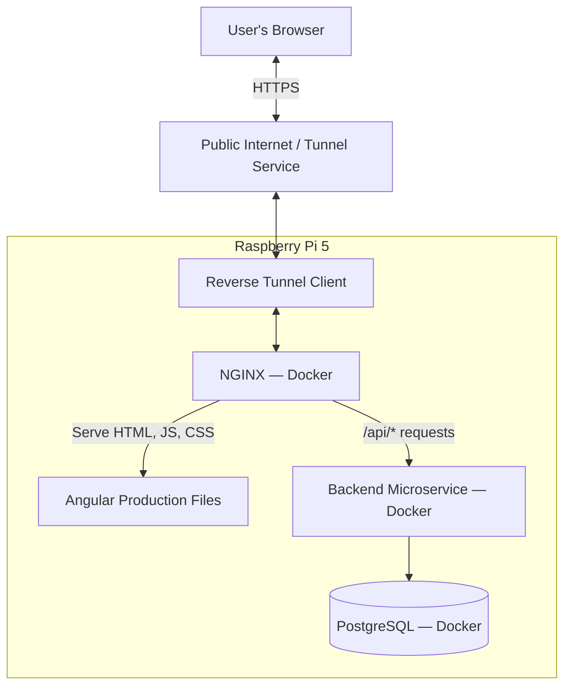
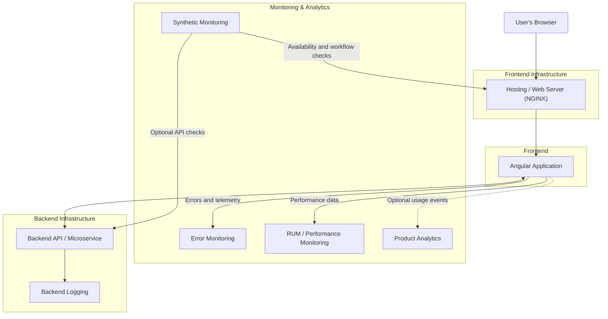

# What other components FE should have

- Excluding source code components

## Components

⚠️ Investigate exact pipeline for each component prior to implementation

- **Hosting & Delivery** (nginx — Docker)
- **Frontend Error monitoring** 
   - tool Grafana Faro Web SDK --> in browser (collector errors & RUM)
   - tool Grafana Alloy --> Docker container (recieves telemetry)
   - tool Loki (logs) + Tempo (traces) --> Docker container (collects and stores logs and traces)
   - tool Grafana --> Docker container (visualizes metrics, logs, and traces)
- **Real User Monitoring (RUM)**
   - tool Grafana Faro Web SDK --> in browser (collector errors & RUM)
   - tool Grafana Alloy --> Docker container (recieves telemetry)
   - tool Loki (logs) + Tempo (traces) --> Docker container (collects and stores logs and traces)
   - tool Grafana --> Docker container (visualizes metrics and logs)
- **Synthetic Monitoring**
   - tool Prometheus Blackbox Exporter --> Docker container (Checks HTTP/HTTPS endpoints, response times, DNS, and TCP connectivity)
   - tool Grafana --> Docker container 'existing' (visualizes synthetic monitoring results)
   - Grafana Alertmanager --> Docker container 'existing' (handles alerts based on synthetic monitoring results)
- **Security Controls**
   - HTTPS (Traffic interception and tampering in transit) --> Docker container 'existing' NGINX
   - HTTP security headers (Certain browser-based attacks) --> Docker container 'existing' NGINX
   - Certbot (Obtains and renews TLS certificates) --> Docker container
   - Authentication and authorization --> Docker container backend service
   - Request protection (Malformed or abusive requests) --> Docker container 'existing' NGINX
   - Network and host security (Unnecessary exposure of services) --> host system hardening
   - Secrets management (Exposure of credentials) --> Docker container HashiCorp Vault
   - Container security (Vulnerabilities within container images) --> CI to scan container images and dependencies prior to deployment with tools like `Trivy`
- **Dependency and vulnerability scanning** --> CI npm audit, Github Dependabot, CI Trivy
- **Analytics** (Depends on business needs). Select the tool based on needs 
   - tool Plausible Analytics --> Docker container (collects and visualizes product analytics)
   - tool Google Analytics --> External service (collects and visualizes product analytics)

**Chart L0**


**Chart L1**


---

# Observability and Monitoring

## Pipelines:
### 1. Frontend telemetry

- **Logs, errors, and frontend events**: Browser (Faro Web SDK) → Alloy → Loki → Grafana. Frontend logs, exceptions, Web Vitals records, and other telemetry events are collected and stored as logs in Loki.

- **Distributed traces**: Browser (Faro Web SDK + Faro Web Tracing) → Alloy → Tempo → Grafana. Browser-generated traces, including instrumented HTTP requests, are collected and stored in Tempo.

- **Observability infrastructure metrics**: Alloy → Prometheus → Grafana. Prometheus scrapes Alloy's exposed metrics, including Faro receiver counters for received events, logs, exceptions, and measurements.

- **Web Vitals metrics**: LCP, INP, and CLS measurements are currently collected as frontend telemetry records in Loki. A separate pipeline to export these individual measurements as Prometheus time series is not currently configured.

    ```
    Browser
    │
    ▼
    Grafana Faro Web SDK
    │
    ▼
    Grafana Alloy
    ├── Logs, errors, events, and Web Vitals records
    │       └──► Loki ──► Grafana
    │
    └── Traces
            └──► Tempo ──► Grafana

    Grafana Alloy ──► Prometheus ──► Grafana
                    (receiver and
                    infrastructure metrics)`
    ```

### 2. Backend telemetry
- Backend instrumentation → Alloy → Loki → Grafana — application logs.
- Backend instrumentation → Alloy → Tempo → Grafana — distributed traces.
- Backend metrics → Prometheus → Grafana — application metrics, if Prometheus is your chosen metrics backend.
### 3. Database telemetry
- PostgreSQL logs → Alloy → Loki → Grafana — database logs.
- Backend database instrumentation → Alloy → Tempo → Grafana — database-operation spans within distributed traces.
- PostgreSQL exporter → Prometheus → Grafana — database performance metrics.

---

An overview of possible frontend telemetry and its actual implementation in the current setup.

## 1. Errors

Errors and exceptions occurring in the browser or application.

| Sub-category | What to test | Expected source | Priority | Part of Setup | Test link | Integration Test | CI Test |
|---|---|---|---|---|---| --- |----|
| Uncaught JavaScript exceptions | Uncaught exception, e.g., `throw new Error(...)` | `ErrorsInstrumentation` | Required | Yes | [Test-001](#test-001) | [Test-001](#test-001) | [test_001_uncaught_exception.py](../../../scripts/ci/observability-fe/errors/test_001_uncaught_exception.py)
| Unhandled promise rejections | Rejected Promise without its own handler | `ErrorsInstrumentation`, if the event bubbles up to a registered handler | Required | Yes | [Test-002](#test-002) | [Test-002](#test-002) | [test_002_unhandled_promise_rejections.py](../../../scripts/ci/observability-fe/errors/test_002_unhandled_promise_rejections.py)
| Console errors | Calls to `console.error(...)` | `ConsoleInstrumentation` | Recommended | Yes | [Test-003](#test-003) | [Test-003](#test-003) | [test_003_cosole_errors.py](../../../scripts/ci/observability-fe/errors/test_003_cosole_errors.py)
| Angular runtime errors | Error caught by Angular error handler | Typically Angular error handler → console; depends on handling method | Required | Yes | [Test-004](#test-004) | [Test-004](#test-004) | [test_004_angular_runtime_errors.py](../../../scripts/ci/observability-fe/errors/test_004_angular_runtime_errors.py)
| Type errors | For example, calling a method on `undefined` | `ErrorsInstrumentation`, if the exception remains unhandled | Required | Yes | [Test-005](#test-005) | [Test-001](#test-001) | 
| Reference errors | Accessing a non-existent variable | `ErrorsInstrumentation`, if the exception remains unhandled | Required | Yes | [Test-006](#test-006) | [Test-001](#test-001) |
| Resource loading errors | Failure to load an image, script, or other resource | Depends on the type of resource and instrumentation | Recommended | Yes | [Test-007](#test-007) | [Test-007](#test-007) |
| Errors with stack traces | Errors containing stack trace | Part of captured errors, if available | Required | Yes | [Test-008](#test-008) | [Test-001](#test-001) |
| Content Security Policy violations | Violation of CSP rules | `CSPInstrumentation`, if active and the browser provides the event | Recommended | Yes | [Test-009](#test-009) | [Test-009](#test-009) |
| Repeated errors | Repetition of the same error | Verify SDK behavior and subsequent aggregation | Recommended | Yes | [Test-010](#test-010) | [Test-010](#test-010) |


## 2. Network

| Sub-category | What to test | Expected source | Priority | Part of Setup | Test link | Integration Test |
|---|---|---|---|---|---| --- |
| Successful HTTP requests | HTTP 200 | Verify that requests are captured | Required | Yes | [Test-011](#test-011) | [Test-011](#test-011) 
| Client errors | HTTP 400, 404 | HTTP error does not automatically mean Faro error | Required | Yes | [Test-012](#test-012) | [Test-012](#test-012) |
| Server errors | HTTP 500 | Verify request capture and any errors | Required  | Yes | [Test-013](#test-013) | [Test-013](#test-013) | 
| Network failures | Unavailable server, interrupted connection | Depends on instrumentation | Required | TBD | [Test-014](#test-014) |[Test-014](#test-014) |
| Request timeout | Timeout expiration | Depends on implementation | Recommended | TBD | TBD | [Test-014](#test-014) |
| Fetch API | Requests via `fetch()` | Verify default support | Required | -- | -- | [Test-011](#test-011)
| XMLHttpRequest | Requests via XHR | Verify default support | Required | TBD | TBD| [Test-011](#test-011) | 
| Request duration | Re quest duration | Depends on instrumentation | Required | TBD | TBD | [Test-011](#test-011) |
| Request metadata | URL, method, and response status | Verify what data is recorded | Required | TBD | TBD | [Test-011](#test-011) |
| CORS failures | CORS errors | Browser may hide some details | Recommended | TBD | TBD | [Test-014](#test-014) |

## 3. Logs

| Sub-category | What to test | Expected source | Priority | Part of Setup | Test link | Integration Test |
|---|---|---| --- | --- | ---- | ---- |
| `console.debug()` | Debug message | `ConsoleInstrumentation` | Recommended | -- | -- | [Test-021](#test-021) |  
| `console.info()` | Informational message | `ConsoleInstrumentation` | Recommended | -- | -- | [Test-021](#test-021)
| `console.log()` | Regular message | `ConsoleInstrumentation` | Recommended | -- | -- | [Test-021](#test-021) |
| `console.warn()` | Warning | `ConsoleInstrumentation` | Required | -- | -- | [Test-021](#test-021)
| `console.error()` | Error message | `ConsoleInstrumentation` | Required | -- | -- | [Test-003](#test-003) |
| Custom application logs | Logs generated by the application via Faro API | Faro API | Required | -- | -- | [Test-022](#test-022) |
| Log message context | Context and metadata of the message | Faro API / instrumentation | Required | -- | -- | [Test-022](#test-022) |
| Log severity / level | Message level and its mapping | Faro → Alloy → Loki |  Required | -- | -- | [Test-023](#test-023) |
| Log filtering | Which messages the SDK ignores or filters | SDK configuration |  Recommended | -- | -- | [Test-023](#test-023) |

## 4. Performance Monitoring

Faro has PerformanceInstrumentation enabled by default, unless it is disabled in the configuration.

| Sub-category | What to test | Expected source |Priority | Part of Setup | Test link | Integration Test |
|---|---|---|---| ---| --- | --- |
| Page load timing | Page load time | Performance API | Required | -- | -- | [Test-030](#test-030)
| Navigation timing | Navigation timing data | Performance API | Required | -- | -- | [Test-030](#test-030) |
| Resource timing | Resource load timing data | Performance API | Required | -- | -- | [Test-031](#test-031) |  
| Long tasks | Long tasks blocking the main thread, if supported by the SDK/browser | Performance API |  Recommended | -- | -- | [Test-031](#test-031) |
| Web Vitals — LCP | Largest Contentful Paint | `WebVitalsInstrumentation` | Required |  -- | -- | [Test-032](#test-032) |
| Web Vitals — CLS | Cumulative Layout Shift | `WebVitalsInstrumentation` | Required |  -- | -- | [Test-031](#test-031) |
| Web Vitals — INP | Interaction to Next Paint | `WebVitalsInstrumentation` | Required |  -- | -- | [Test-031](#test-031) |
| Web Vitals — FCP | First Contentful Paint | `WebVitalsInstrumentation` |  Recommended |  -- | -- | [Test-031](#test-031) |
| Web Vitals — TTFB | Time to First Byte | `WebVitalsInstrumentation` |  Recommended |  -- | -- | [Test-031](#test-031) | 
| User interactions | Clicks and other user actions according to instrumentation |   `UserActionInstrumentation` |   Recommended |  -- | -- | [Test-032](#test-032) |
| Performance measurements | Custom measurements via the Performance API | Depends on instrumentation and configuration |   Recommended | -- | -- | [Test-032](#test-032) |

## 5. Host performance

**Mostly not applicable to frontend observability**. These are infrastructure and backend monitoring capabilities, not telemetry generated by Angular application.

| Subcategory | Examples | Typical collection method | Priority | Part of Setup | Test link | Integration Test |
|---|---|---|---|---|---|---|
| CPU | Utilization, load average | Node Exporter or host metrics agent | Optional | -- | -- | No |
| Memory | Total, used, available, swap | Node Exporter | Optional | -- | -- | No |
| Disk capacity | Free space, filesystem utilization | Node Exporter | Optional | -- | -- | No |
| Disk I/O | Read/write throughput, latency | Node Exporter | Optional | -- | -- | No |
| Network | Throughput, errors, dropped packets | Node Exporter | Optional | -- | -- | No |
| System health | Uptime, load, resource pressure | Host metrics exporter | Optional | -- | -- | No |
| Temperature | CPU/SoC temperature | Raspberry Pi-specific system metrics collector | Optional | -- | -- | No |
| Processes | Process counts and resource usage | Host monitoring tools | Optional | -- | -- | No |
| Docker containers | CPU, memory, restarts, health | cAdvisor or suitable container metrics collection | Optional | -- | -- | No |
| NGINX | Requests, response codes, connections, latency | NGINX metrics exporter or supported integration | Optional | -- | -- | No |
| Backend application | Request rate, errors, latency | Application instrumentation or metrics endpoint | Optional | -- | -- | No |
| PostgreSQL | Connections, transactions, query performance | PostgreSQL exporter | Optional | -- | -- | No |
| Reverse tunnel | Connectivity, availability, reconnects | Tunnel-specific monitoring or external health checks | Optional | -- | -- | No |

## 6. Navigation & Session

| Sub-category | What to test | Expected source | Priority | Part of Setup | Test link | Integration Test |
|---|---|---|--- | ---- |---|---|
| Page views / views | Observation of page or view | `ViewInstrumentation` | Required | -- | -- | [Test-040](#test-040) |
| Route changes | Navigation between Angular routes | Depends on configuration and integration | Required | -- | -- | [Test-041](#test-041) | 
| Browser navigation | Browser navigation | `NavigationInstrumentation`, according to settings | Recommended | -- | -- | [Test-041](#test-041) |
| Session information | Session information | `SessionInstrumentation` | Required | -- | -- | [Test-043](#test-043) |
| User actions | User actions | `UserActionInstrumentation` | Recommended |  -- | -- | [Test-044](#test-044) |
| Session correlation | Correlation of events with the session | Faro metadata | Required |  -- | -- | [Test-043](#test-043) |
| App identity | Application name and version | Configuration `app` | Required |  -- | -- | [Test-043](#test-043) |

## 7. Traces

| Sub-category | What to test | Note | Priority | Part of Setup | Test link | Integration Test |
|---|---|---| --- |---|---|---|
| Frontend spans | Individual operations in the browser | Requires supported tracing instrumentation | Required | -- | -- | [Test-047](#test-047) |
| HTTP client spans | Frontend HTTP requests represented as spans | Verify Faro SDK support and configuration |  Required | -- | -- | [Test-048](#test-048) |
| Trace IDs | Unique identifier for an entire trace | Generated or propagated by tracing instrumentation | Required | -- | -- | [Test-047](#test-047) |
| Span IDs | Unique identifier for an individual span | Generated by tracing instrumentation |  Required | -- | -- | [Test-047](#test-047) |
| Parent-child span relationships | Correct relationships between related operations | Verify parent and child span context |  Required | -- | -- | [Test-048](#test-048) |
| Trace propagation | Passing trace context over HTTP | Requires compatible instrumentation, headers, and CORS configuration |  Required | -- | -- | [Test-049](#test-049) |
| Backend spans | Backend operations represented as spans | Requires backend tracing instrumentation |  Recommended | -- | -- | [Test-053](#test-053) |
| Database spans | Database queries and operations represented as spans | Requires backend/database client instrumentation |  Optional | -- | -- | [Test-053](#test-053) |
| End-to-end traces | Linking browser → backend → database | Requires instrumentation and context propagation across components |  Required | -- | -- | [Test-053](#test-053) |
| Span attributes | HTTP method, route, status code, service name, and other relevant metadata | Verify which attributes are recorded |   Required | -- | -- | [Test-047](#test-047) |
| Span events | Events recorded within a span | Requires instrumentation that emits span events |   Recommended | -- | -- | [Test-048](#test-048) |
| Error recording | Exceptions, error status, and relevant details on spans | Depends on instrumentation and error handling | Required | -- | -- | [Test-048](#test-048) |
| Trace sampling | Whether traces are recorded or discarded | Depends on SDK and collector configuration |    Recommended | -- | -- | [Test-059](#test-059) |
| Tempo ingestion | Confirm Alloy successfully forwards traces to Tempo | Verify receiver/exporter configuration and Tempo availability |  Required | -- | -- | [Test-060](#test-060) |
| Trace querying | Search for traces in Grafana | Requires a working Tempo data source |  Required | -- | -- | [Test-060](#test-060) |
| Trace-to-logs correlation | Navigate from a trace to related logs | Requires compatible trace IDs and log metadata |   Recommended | -- | -- | [Test-062](#test-062) |
| Trace-to-metrics correlation | Navigate between traces and relevant metrics | Requires appropriate metric labels and Grafana configuration | Optional | -- | -- | [Test-062](#test-062) |
| Trace retention | Verify how long traces remain available | Depends on Tempo storage and retention configuration |   Recommended | -- | -- | [Test-060](#test-060) |
| Pipeline resilience | Behavior when Alloy or Tempo is unavailable | Verify buffering, retries, and recovery behavior where supported |   Recommended | -- | -- | [Test-060](#test-060) |

## 8. Metrics

| Sub-category | What to test | Note | Priority | Part of Setup | Test link | Integration Test |
|---|---|---|---|---|---|---|
| Web Vitals | LCP, CLS, INP and other supported metrics | Can be sent as Faro events | Required | -- | -- | [Test-066](#test-066) |
| Page performance | Page load times | Depends on instrumentation | Required |  -- | -- | [Test-067](#test-067) |
| Resource performance | Resource load times | Depends on instrumentation | Required |  -- | -- | [Test-067](#test-067) |
| Custom measurements | Custom numeric values | Require appropriate API/instrumentation | Recommended |  -- | -- | [Test-069](#test-069) |
| Application counters | Counts of clicks, errors, or operations | Usually require custom implementation | Recommended |  -- | -- | [Test-069](#test-069) |
| Backend metrics | CPU, memory, request rate, latency | Requires backend monitoring | Optional | No | No | Outside frontend scope |
| Infrastructure metrics | CPU/RAM Raspberry Pi, Docker, and others | Requires system instrumentation | Optional | No | No | Outside frontend scope |

## 9. User Actions

| Sub-category | What to test |  Note | Priority | Part of Setup | Test link | Integration Test |
|---|---|---|----|----|----|----|             
| Clicks | Clicks on buttons and elements | -- | Recommended | -- | -- | [Test-071](#test-071) |
| User input interactions | Interactions with forms | -- | Recommended | -- | -- | [Test-071](#test-071) |
| Action names | How events are named | -- | Required | -- | -- | [Test-073](#test-073) 
| Action context | Context of the interaction | -- | Required | -- | -- | [Test-073](#test-073) 
| Navigation after interaction | Interaction leading to navigation |  -- | Recommended | -- | -- | [Test-075](#test-075) 
| Error after interaction | Error occurring after interaction | -- | Required | -- | -- | [Test-076](#test-076) 
| Action duration | Duration of an interaction or operation |  -- | Optional | -- | -- | [Test-073](#test-073) 
| User identification / session association | Association of actions with session and available user context |  -- | Required | -- | -- | [Test-073](#test-073) 

## 10. Security & browser diagnostics

| Sub-category | What to test |  Note | Priority | Part of Setup | Test link | Integration Test |
|---|---|---|---|---|---|---|
| Content Security Policy | CSP violations reported by the browser | -- | Recommended | -- | -- | [Test-009](#test-009) |
| Blocked resources | Resources blocked by CSP or browser restrictions | -- | Recommended | -- | -- | [Test-080](#test-080) |
| CORS diagnostics | Incorrect CORS configuration and resulting failures | -- | Recommended | -- | -- | [Test-014](#test-014) |
| Browser restrictions | Browser restrictions affecting telemetry collection or submission | -- | Required | -- | -- | [Test-082](#test-082) |
| Payload size limits | Rejection or handling of oversized telemetry payloads | -- | Recommended | -- | -- | [Test-083](#test-083) |
| Receiver rate limiting | Handling of requests exceeding Alloy receiver limits | -- | Recommended | -- | -- | [Test-083](#test-083) |
| Invalid telemetry payloads | Handling of malformed telemetry payloads | -- | Recommended | -- | -- | [Test-083](#test-083) |
| Sensitive data protection | Preventing passwords, tokens and personal data from entering telemetry | -- | Required | -- | -- | [Test-086](#test-086) |
| Telemetry transport security | HTTPS and secure transmission of telemetry | -- | Reuired | -- | -- | [Test-082](#test-082) |

## 11. Telemetry Pipeline & Delivery

| Sub-category | What to test | Note | Priority | Part of Setup | Test link | Integration Test |
|---|---|---|---|---|---|---|
| Faro initialization | SDK initializes | -- | Required | -- | -- | [Test-088](#test-088) 
| Telemetry submission | Browser sends requests to Alloy | -- | Required | -- | -- | [Test-089](#test-089) 
| CORS | Alloy accepts requests from Angular origin |  -- | Required | -- | -- | [Test-089](#test-089) 
| Receiver availability | Alloy receiver is available |  -- | Required | -- | -- | [Test-091](#test-091) 
| Payload acceptance | Alloy accepts telemetry |  -- | Required | -- | -- | [Test-091](#test-091) 
| Loki ingestion | Logs arrive in Loki |  -- | Required | -- | -- | [Test-093](#test-093) 
| Label mapping | Correct Loki labels |  -- | Required | -- | -- | [Test-093](#test-093)
| Log content | Correct log content |  -- | Required | -- | -- | [Test-093](#test-093)
| Grafana queries | Data can be found using LogQL |  -- | Required | -- | -- | [Test-096](#test-096)
| Dashboard panels | Panels display expected events |  -- | Recommended | -- | -- | [Test-096](#test-096)
| Persistence | Data survive container restarts according to configuration |   -- | Required | -- | -- | [Test-098](#test-098)
| Network interruption | Behaviour during receiver outage and recovery |    -- | Recommended | -- | -- | [Test-099](#test-099) |
| Duplicate events | Detect unintended duplicate telemetry | -- | Recommended | -- | -- | [Test-100](#test-100) | 
| Sampling / filtering | Events filtered or sampled before storage |  -- | Recommended | -- | -- | [Test-100](#test-100) | 
| Tempo ingestion | Traces arrive in Tempo |  -- | Required | -- | -- | [Test-060](#test-060) |
| Metrics ingestion | Metrics arrive in their configured backend | -- | Required | -- | -- | [Test-103](#test-103) |
| Data integrity | Telemetry retains expected attributes throughout the pipeline | -- | Required | -- | -- | [Test-093](#test-093) |   


**Expected architecture:**

`Browser (Faro) → Alloy → Tempo → Grafana`

`Backend instrumentation → Alloy → Tempo → Grafana`

`Database operations → Backend tracing instrumentation → Alloy → Tempo → Grafana`

**Important:** Tempo stores and queries traces; it does not automatically instrument the frontend, backend, or database. Alloy must be configured to receive and forward trace data, and each application component must generate spans or propagate trace context as appropriate.

The existing Faro → Alloy → Loki pipeline can remain in place for logs and frontend events. Trace data should be routed to Tempo separately.

# Tests

## Test-001

**Name: Uncaught Javascript exception**<br>
**Category:** Required<br>
**Expected Source:** Faro ErrorsInstrumentation<br>
**Expected destination:** Loki, accesible through Grafana<br>
**Test type:** Manual integration test<br> 
**Precondition:** Default Grafana stack (see [Frontend telemetry](#1-frontend-telemetry))

### Other Precondition
- Frontend app serves
- Grafana stack enabled (grafana, loki, tempo, prometheus)

### Procedure
1. Open the Angular application in a browser.
2. Open Developer Tools and select the Console tab.
3. Execute the following command in the browser console:
    ```javascript
    setTimeout(() => { throw new Error('OBS-TEST-001: uncaught JavaScript exception'); }, 0);
    ```
4. Confirm that the browser console displays the expected exception.
5. Inspect the browser Network tab and identify the outgoing Faro telemetry request, if one is generated.<br>
5.1 Open Browser/Inspect/Networks click options and select `Persist Logs`<br>
5.2 Clen logs<br>
5.3 Execute command `step 3.` in console<br>
5.4 The Network tab displays an outgoing request to the configured Faro receiver in Grafana Alloy
6. Open Grafana Explorer and select the Loki as source
7. Select code and search query and `refresh`
   ```
   {service_name="front-end"} |= "OBS-TEST-001: uncaught JavaScript exception"
   ```

### Expected results
- The browser reports the generated exception (Ref. step 4). --> `Yes`
- The Network tab displays an outgoing request to the configured Faro receiver in Grafana Alloy (Ref. step 5.) --> yes
  ```
  Status Method   Domain          File 
  200    POST     localhost:12345 collect
  204    OPTIONS  localhost:12345 collect
  ```
- Logs catched by grafana in explorer section `Logs`
  ```markdown
  2026-10-29 14:12:52.909 error timestamp="2026-10-29 13:12:52.806 +0000 UTC" kind=exception type=Error value="console.error: ERROR Error: OBS-TEST-001: uncaught JavaScript exception" stacktrace="Error: console.error: ERROR Error: **OBS-TEST-001: uncaught JavaScript exception**\n  at initialize/this.subscription< (http://localhost:4200/@fs/home/devon90/Desktop/04_Today_Work/test-fe-monitor/apps/front-end/.angular/cache/20.3.40/front-end/vite/deps/chunk-SVZFW7SU.js?v=7afc8ef5:3824:32)\n  at notify/< (http://localhost:4200/@fs/home/devon90/Desktop/04_Today_Work/test-fe-monitor/apps/front-end/.angular/cache/20.3.40/front-end/vite/deps/chunk-SVZFW7SU.js?v=7afc8ef5:1670:56)\n  at notify (http://localhost:4200/@fs/home/devon90/Desktop/04_Today_Work/test-fe-monitor/apps/front-end/.angular/cache/20.3.40/front-end/vite/deps/chunk-SVZFW7SU.js?v=7afc8ef5:1670:22)\n  at monitorConsole/</console[level] (http://localhost:4200/@fs/home/devon90/Desktop/04_Today_Work/test-fe-monitor/apps/front-end/.angular/cache/20.3.40/front-end/vite/deps/chunk-SVZFW7SU.js?v=7afc8ef5:3720:27)\n  at handleError (http://localhost:4200/@fs/home/devon90/Desktop/04_Today_Work/test-fe-monitor/apps/fron
  ```


### Pass 

`YES`

### Default

YES

### Limitations

This test verifies one uncaught JavaScript exception. It does not prove that Angular-handled exceptions or every other error type is captured.

---

## Test-002

**Name: Unhandled promise rejections**<br>
**Category:** Required<br>
**Expected Source:** Faro ErrorsInstrumentation<br>
**Expected destination:** Loki, accesible through Grafana<br>
**Test type:** Manual integration test<br> 
**Precondition:** Default Grafana stack (see [Frontend telemetry](#1-frontend-telemetry))

### Other Precondition
- Frontend app serves
- Grafana stack enabled (grafana, loki, tempo, prometheus)

### Procedure
1. Open the Angular application in Firefox.
2. Open Developer Tools and select the Console tab.
3. Execute the following command in the browser console:
    ```javascript
    setTimeout(() => {
        Promise.reject(
            new Error('OBS-TEST-002: unhandled promise rejection')
        );
    }, 0);
    ```
4. Confirm that the browser console displays an unhandled promise rejection containing the message OBS-TEST-002: unhandled promise rejection.
5. Inspect the browser Network tab and identify the outgoing Faro telemetry request, if one is generated.<br>
5.1. Open Developer Tools and select the Network tab.<br>
5.2. Ensure that Persist Logs is enabled.<br>
5.3. Clear the existing network requests.<br>
5.4. Return to the Console tab and execute the command from step 3 again.<br>
6. Open Grafana Explore and select Loki as the data source.
7. Select the Code query editor and execute the following LogQL query: 
    ```
    {service_name="front-end"} |= "OBS-TEST-002: unhandled promise rejection"
    ```

### Expected results
- The browser reports the generated exception (Ref. step 4). --> `Yes`
- The Network tab displays an outgoing request to the configured Faro receiver in Grafana Alloy (Ref. step 5.) --> yes
  ```
  Status Method   Domain          File 
  200    POST     localhost:12345 collect
  204    OPTIONS  localhost:12345 collect
  ```
- Logs catched by grafana in explorer section `Logs`
  ```markdown
  2026-10-29 15:24:15.111 error timestamp="2026-10-29 14:24:15.084 +0000 UTC" kind=exception type=Error value="console.error: **OBS-TEST-002: unhandled promise rejection**" stacktrace="Error: console.error: OBS-TEST-002: unhandled promise rejection\n  at timer (http://localhost:4200/@fs/home/devon90/Desktop/04_Today_Work/test-fe-monitor/apps/front-end/.angular/cache/20.3.40/front-end/vite/deps/zone__js.js?v=7afc8ef5:1439:27)\n  at invokeTask (http://localhost:4200/@fs/home/devon90/Desktop/04_Today_Work/test-fe-monitor/apps/front-end/.angular/cache/20.3.40/front-end/vite/deps/zone__js.js?v=7afc8ef5:360:171)\n  at runTask (http://localhost:4200/@fs/home/devon90/Desktop/04_Today_Work/test-fe-monitor/apps/front-end/.angular/cache/20.3.40/front-end/vite/deps/zone__js.js?v=7afc8ef5:141:37)\n
  ...  
  ``` 

### Pass 

Yes

### Default

YES

### Limitations
This test verifies one Unhandled promise rejections. It does not prove that Angular-handled exceptions or every other error type is captured.

---

## Test-003

**Name: Cosole Errors**<br>
**Category:** Required<br>
**Expected Source:** Faro ConsoleInstrumentation<br>
**Expected destination:** Loki, accesible through Grafana<br>
**Test type:** Manual integration test<br> 
**Precondition:** Default Grafana stack (see [Frontend telemetry](#1-frontend-telemetry))

### Other Precondition
- Frontend app serves
- Grafana stack enabled (grafana, loki, tempo, prometheus)

### Procedure
1. Open the Angular application in Firefox.
2. Open Developer Tools and select the Console tab.
3. Execute the following command in the browser console:
    ```
    console.error('OBS-TEST-003: console error test');
    ```
4. Confirm that the browser console displays OBS-TEST-003: console error test.
5. Inspect the browser Network tab and identify the outgoing Faro telemetry request, if one is generated.<br>
5.1. Open Developer Tools and select the Network tab.<br>
5.2. Ensure that Persist Logs is enabled.<br>
5.3. Clear the existing network requests.<br>
5.4. Return to the Console tab and execute the command from step 3 again.<br>
6. Open Grafana Explore and select Loki as the data source.
7. Select the Code query editor and execute the following LogQL query:
    ```
    {service_name="front-end"} |= "OBS-TEST-003: console error test"
    ```

### Expected results
- The browser reports the generated exception (Ref. step 4). --> `Yes`
- The Network tab displays an outgoing request to the configured Faro receiver in Grafana Alloy (Ref. step 5.) --> yes
  ```
  Status Method   Domain          File 
  200    POST     localhost:12345 collect
  204    OPTIONS  localhost:12345 collect
  ```
- Logs catched by grafana in explorer section `Logs`
  ```markdown
  2026-10-29 15:41:18.479 error timestamp="2026-10-29 14:41:18.268 +0000 UTC" kind=exception type=Error value="console.error: **OBS-TEST-003: console error test**" stacktrace="Error: console.error: OBS-TEST-003: console error test\n  at initialize/this.subscription< (http://localhost:4200/@fs/home/devon90/Desktop/04_Today_Work/test-fe-monitor/apps/front-end/.angular/cache/20.3.40/front-end/vite/deps/chunk-SVZFW7SU.js?v=7afc8ef5:3824:32)\n
  ...
  ```

### Pass 

YES

### Default

YES

### Limitations

This test verifies one Cosole Error. It does not prove that Angular-handled exceptions or every other error type is captured.

---

## Test-004

**Name: Angular runtime errors**<br>
**Category:** Required<br>
**Expected Source:** Angular ErrorHandler → console / Faro ConsoleInstrumentation<br>
**Expected destination:** Loki, accesible through Grafana<br>
**Test type:** Manual integration test<br> 
**Precondition:** Default Grafana stack (see [Frontend telemetry](#1-frontend-telemetry))

### Other Precondition
- Frontend app serves
- Grafana stack enabled (grafana, loki, tempo, prometheus)

### Procedure
1. Open Angular project.
2. Temporarily add function to e.g. `app.ts`
   ```typescript
   triggerRuntimeError(): void {
        throw new Error('OBS-TEST-004: Angular runtime error test');
    }
   ``` 
3. Temporarily add button to e.g. `app.html`
   ```html
   <button (click)="triggerRuntimeError()">Test Angular runtime error</button>
   ```
4. Run the application and open it in Firefox.
5. Click Test Angular runtime error.
6. Confirm the error is reported by Angular’s error handler in the browser console.
7. Inspect the browser Network tab and identify the outgoing Faro telemetry request, if one is generated.<br>
7.1. Open Developer Tools and select the Network tab.<br>
7.2. Ensure that Persist Logs is enabled.<br>
7.3. The Network tab displays an outgoing request.
8. Open Grafana Explore and select Loki as the data source.
9. Select the Code query editor and execute the following LogQL query:
    ```
    {service_name="front-end"} |= "OBS-TEST-004: Angular runtime error test"
    ```
10. Remove temporary function and button from Angular app. 

### Expected results
- Clicking the button triggers the error and show in console.
- The Network tab displays an outgoing request to the configured Faro receiver in Grafana Alloy (Ref. step 7.) --> yes
  ```
  Status Method   Domain          File 
  200    POST     localhost:12345 collect
  204    OPTIONS  localhost:12345 collect
  ```
- Logs catched by grafana in explorer section `Logs`
  ```markdown
  2026-10-29 16:24:21.493 error timestamp="2026-10-29 15:24:21.453 +0000 UTC" kind=exception type=Error value="console.error: ERROR Error: **OBS-TEST-004: Angular runtime error test**" stacktrace="Error: console.error: ERROR Error: OBS-TEST-004: Angular runtime error test\n...
  ``` 

### Pass 

YES

### Default

YES

### Limitations
This test verifies one Angular runtime error. It does not prove that Angular-handled exceptions or every other error type is captured.

---

## Test-005

**Name: Type Errors**<br>
**Category:** Required<br>
**Expected Source:** Faro ErrorsInstrumentation<br>
**Expected destination:** Loki, accesible through Grafana<br>
**Test type:** Manual integration test<br> 
**Precondition:** Default Grafana stack (see [Frontend telemetry](#1-frontend-telemetry))

### Other Precondition
- Frontend app serves
- Grafana stack enabled (grafana, loki, tempo, prometheus)

### Procedure
1. Open the Angular application in Firefox.
2. Open Developer Tools and select the Console tab.
3. Execute:
    ```javascript
    setTimeout(() => {
       const testValue = undefined;
       testValue.someMethod();
    }, 0);
    ```
4. Confirm that the browser console displays a TypeError. 
5. Inspect the browser Network tab and identify the outgoing Faro telemetry request, if one is generated.<br>
5.1. Ensure that Persist Logs is enabled.<br>
5.2. Clear existing network requests.<br>
5.3. Return to the Console tab and execute step 3 again.<br>
6. Open Grafana Explore and select Loki as the data source.
7. Select the Code query editor and execute the following LogQL query:
    ```
    {service_name="front-end"} |= "ERROR TypeError"
    ```

### Expected results
- Browser console displays error `TypeError` --> yes
- The Network tab displays an outgoing request to the configured Faro receiver in Grafana Alloy (Ref. step 5.) --> yes
  ```
  Status Method   Domain          File 
  200    POST     localhost:12345 collect
  204    OPTIONS  localhost:12345 collect
  ```
- Logs catched by grafana in explorer section `Logs`
   ```markdown
   2026-10-29 16:44:10.120 error timestamp="2026-10-29 15:44:10.002 +0000 UTC" kind=exception type=Error value="console.error: **ERROR TypeError**: can't access property \"someMethod\", testValue is undefined" stacktrace="Error: console.error: ERROR TypeError: can't access property \"someMethod\", testValue is undefined\n  at initialize/this.subscription< (http://localhost:4200/@fs/home/devon90/Desktop/04_Today_Work/test-fe-monitor/apps/front-end/.angular/cache/20.3.40/front-end/vite/deps/chunk-SVZFW7SU.js?v=7afc8ef5:3824:32)\n ...
   ```

### Pass 

YES

### Default

YES

### Limitations

This test verifies one Error Type. It does not prove that Angular-handled exceptions or every other error type is captured.

---

## Test-006

**Name: Reference Errors**<br>
**Category:** Required<br>
**Expected Source:** Faro ErrorsInstrumentation<br>
**Expected destination:** Loki, accesible through Grafana<br>
**Test type:** Manual integration test<br> 
**Precondition:** Default Grafana stack (see [Frontend telemetry](#1-frontend-telemetry))

### Other Precondition
- Frontend app serves
- Grafana stack enabled (grafana, loki, tempo, prometheus)

### Procedure
1. Open the Angular application in Firefox.
2. Open Developer Tools and select the Console tab.
3. Execute:
    ```javascript
    setTimeout(() => {
       nonExistentTestVariable;
    }, 0);
    ```
4. Confirm that the browser console displays a ReferenceError.
5. Inspect the browser Network tab and identify the outgoing Faro telemetry request.<br>
5.1. Ensure that Persist Logs is enabled.<br>
5.2. Clear existing network requests.<br>
5.3. Return to the Console tab and execute step 3 again.<br>
6. Open Grafana Explore and select Loki as the data source.
7. Select the Code query editor and execute:
    ```
    {service_name="front-end"} |= "nonExistentTestVariable"
    ```

### Expected results
- Browser console displays error `ReferenceError` --> yes
- The Network tab displays an outgoing request to the configured Faro receiver in Grafana Alloy (Ref. step 5.) --> yes
  ```
  Status Method   Domain          File 
  200    POST     localhost:12345 collect
  204    OPTIONS  localhost:12345 collect
  ```
- Logs catched by grafana in explorer section `Logs`
  ```markdown
  2026-10-30 07:13:10.872 error timestamp="2026-10-30 06:13:10.829 +0000 UTC" kind=exception type=Error value="console.error: ERROR ReferenceError: nonExistentTestVariable is not defined" stacktrace="Error: console.error: **ERROR ReferenceError**: nonExistentTestVariable is not defined\n  at initialize/this.subscription< (http://localhost:4200/@fs/home/devon90/Desktop/04_Today_Work/test-fe-monitor/apps/front-end/.angular/cache/20.3.40/front-end/vite/deps/chunk-SVZFW7SU.js?v=7afc8ef5:3824:32)\n  at notify/< (http://localhost:4200/@fs/home/devon90/Desktop/04_Today_Work/test-fe-monitor/apps/front-end/.angular/cache/20.3.40/front-end/vite/deps/chunk-SVZFW7SU.js?v=7afc8ef5:1670:56)\n ...
  ```

### Pass 

YES

### Default

YES

### Limitations

This test verifies one Reference Error. It does not prove that Angular-handled exceptions or every other error type is captured.

---

## Test-007

**Name: Resource loading errors**<br>
**Category:** Required<br>
**Expected Source:** Browser resource error event → Custom ResourceErrorsInstrumentation → Faro<br>
**Expected destination:** Loki, accesible through Grafana<br>
**Test type:** Manual integration test<br> 
**Precondition:** Default Grafana stack (see [Frontend telemetry](#1-frontend-telemetry))

### Other Precondition
- Frontend app serves
- Grafana stack enabled (grafana, loki, tempo, prometheus)

### Procedure
1. Open the Angular application in Firefox.
2. Open Developer Tools and select the Console tab.
3. Execute:
   ```javascript
   const img = new Image();
   img.src = `${location.origin}/OBS-TEST-007-missing-image.png`;
   document.body.appendChild(img);
   ```
4. Confirm that the browser reports a failed image loading request.
5. Inspect the browser Network tab and identify the failed image request.<br>
5.1. Ensure that Persist Logs is enabled.<br>
5.2. Clear existing network requests.<br>
5.3. Return to the Console tab and execute step 3 again.<br>
6. Open Grafana Explore and select Loki as the data source.
7. Select the Code query editor and execute:
    ```
    {service_name="front-end"} |= "OBS-TEST-007-missing-image.png"
    ```

### Expected results
- Browser reports a failed image loading request (404 Not Found).
- The Network tab displays an outgoing request to the configured Faro receiver in Grafana Alloy (Ref. step 5.) --> yes
  ```
  Status Method   Domain          File 
  200    POST     localhost:12345 collect
  204    OPTIONS  localhost:12345 collect
  ```
- Logs catched by grafana in explorer section `Logs`
   ```markdown
   2026-10-30 08:51:03.164 timestamp="2026-10-30 07:51:03.029 +0000 UTC" kind=exception type=ResourceLoadError value="Resource loading failed: http://localhost:4200/**OBS-TEST-007-missing-image.png"** stacktrace="ResourceLoadError: Resource loading failed: http://localhost:4200/OBS-TEST-007-missing-image.png\n  at initialize/< (http://localhost:4200/main.js:191:28)\n  at invokeTask (http://localhost:4200/@fs/home/devon90/Desktop/04_Today_Work/test-fe-monitor/apps/front-end/.angular/cache/20.3.40/front-end/vite/deps/zone__js.js?v=d9596979:360:171)\n ...
   ```


### Pass 

YES

### Default

- No
- Implemented via
   ```
   /apps/front-end/src/app/core/observability$ tree -L 3
    .
    ├── faro.ts
    └── instrumentations
        └── resource-errors.instrumentation.ts
   ``` 

### Limitations

This test verifies one Resource loading Error. It does not prove that Angular-handled exceptions or every other error type is captured.

---

## Test-008

**Name: Errors with stack trace**<br>
**Category:** Required<br>
**Expected Source:** Faro ErrorsInstrumentation<br>
**Expected destination:** Loki, accesible through Grafana<br>
**Test type:** Manual integration test<br> 
**Precondition:** Default Grafana stack (see [Frontend telemetry](#1-frontend-telemetry))

### Other Precondition
- Frontend app serves
- Grafana stack enabled (grafana, loki, tempo, prometheus)

### Procedure
1. Open the Angular application in Firefox.
2. Open Developer Tools and select the Console tab.
3. Execute:
   ```javascript
   function testStackTraceLevel1() {
      testStackTraceLevel2();
    }

    function testStackTraceLevel2() {
      testStackTraceLevel3();
    }

    function testStackTraceLevel3() {
      throw new Error('OBS-TEST-008: stack trace test');
    }

    setTimeout(() => testStackTraceLevel1(), 0);
   ```
4. Confirm that the browser reports a failed image loading request.
5. Inspect the browser Network tab and identify the outgoing Faro telemetry request.<br> 
5.1. Ensure that Persist Logs is enabled.<br>
5.2. Clear existing network requests.<br>
5.3. Return to the Console tab and execute step 3 again.<br>
6. Open Grafana Explore and select Loki as the data source.
7. Select the Code query editor and execute:
   ```
   {service_name="front-end"} |= "OBS-TEST-008: stack trace test"
   ```

### Expected results
- Browser console displays error `Error` --> yes
- The Network tab displays an outgoing request to the configured Faro receiver in Grafana Alloy (Ref. step 5.) --> yes
  ```
  Status Method   Domain          File 
  200    POST     localhost:12345 collect
  204    OPTIONS  localhost:12345 collect
  ```
- Logs catched by grafana in explorer section `Logs`
   ```markdown
   2026-10-30 09:09:42.978 error timestamp="2026-10-30 08:09:42.84 +0000 UTC" kind=exception type=Error value="console.error: **ERROR Error: OBS-TEST-008: stack trace test"** stacktrace="Error: console.error: ERROR Error: OBS-TEST-008: stack trace test\n  at initialize/this.subscription< (http://localhost:4200/@fs/home/devon90/Desktop/04_Today_Work/test-fe-monitor/apps/front-end/.angular/cache/20.3.40/front-end/vite/deps/chunk-JDNEPEXO.js?v=d9596979:2313:32)\n ...
   ```


### Pass

YES

### Default

YES

### Limitations

This test verifies one Errors with stack traces. It does not prove that Angular-handled exceptions or every other error type is captured.

---

## Test-009

**Name: Content Security Policy violations**<br>
**Category:** Required<br>
**Expected Source:** Faro CSPInstrumentation<br>
**Expected destination:** Loki, accesible through Grafana<br>
**Test type:** Manual integration test<br> 
**Precondition:** Default Grafana stack (see [Frontend telemetry](#1-frontend-telemetry))

### Other Precondition
- Frontend app serves
- Grafana stack enabled (grafana, loki, tempo, prometheus)

### Procedure
1. Open the Angular project.
2. Open src/index.html.
3. Temporarily add the following CSP meta tag inside <head>:
    ```html
    <meta http-equiv="Content-Security-Policy" content="img-src 'self'">
    ```
4. Run the application and open it in Firefox.
5. Open Developer Tools and select the Console tab.
6. Execute:
    ```javascript
    const img = new Image();
    img.src = 'https://example.com/OBS-TEST-009-csp-image.png';
    document.body.appendChild(img);
    ```
7. Confirm that Firefox reports a CSP violation and blocks the image.
8. Inspect the browser Network tab and identify the outgoing Faro telemetry request.<br> 
8.1. Ensure that Persist Logs is enabled.<br>
8.2. Clear existing network requests.<br>
8.3. Return to the Console tab and execute step 3 again.<br>
9. Open Grafana Explore and select Loki as the data source.
10. Search for the CSP violation:
    ```
    {service_name="front-end"} |= "securitypolicyviolation"
    ```
11. Remove CSP meta tag from `index.html`

### Expected results
- Firefox reports a CSP violation and blocks the image --> Yes
- The Network tab displays an outgoing request to the configured Faro receiver in Grafana Alloy (Ref. step 8.) --> yes
  ```
  Status Method   Domain          File 
  200    POST     localhost:12345 collect
  204    OPTIONS  localhost:12345 collect
  ```
- Logs catched by grafana in explorer section `Logs`
   ```markdown
   2026-10-30 09:29:49.870 timestamp="2026-10-30 08:29:49.74 +0000 UTC" kind=event event_name=**securitypolicyviolation** event_domain=browser event_data_blockedURI=https://example.com/OBS-TEST-009-csp-image.png event_data_columnNumber=1 event_data_disposition=enforce event_data_documentURI=http://localhost:4200/ event_data_effectiveDirective=img-src event_data_lineNumber=2 event_data_originalPolicy="img-src 'self'" event_data_sourceFile="debugger eval code" event_data_statusCode=200 event_data_violatedDirective=img-src sdk_name=faro-web sdk_version=2.12.1 app_name=front-end app_version=1.0.0 session_id=BxmGB2HQ9Q page_url=http://localhost:4200/ browser_name=Firefox browser_version=157.0 browser_os="Ubuntu unknown" browser_mobile=false browser_userAgent="Mozilla/5.0 
   ```

### Pass

YES

### Default

YES

### Limitations

This test verifies one Content Security Policy violations Error. It does not prove that Angular-handled exceptions or every other error type is captured.

---

## Test-010

**Name: Repeated errors**<br>
**Category:** Required<br>
**Expected Source:** Faro ErrorsInstrumentation / Faro error deduplication<br>
**Expected destination:** Loki, accesible through Grafana<br>
**Test type:** Manual integration test<br> 
**Precondition:** Default Grafana stack (see [Frontend telemetry](#1-frontend-telemetry))

### Other Precondition
- Frontend app serves
- Grafana stack enabled (grafana, loki, tempo, prometheus)
- Faro error deduplication enabled (default configuration)

### Procedure
1. Open the Angular application in Firefox.
2. Open Developer Tools and select the Console tab.
3. Execute the following code:
    ```javascript
    function triggerRepeatedError() {
       throw new Error('OBS-TEST-010: repeated error test');
    }

    for (let i = 0; i < 5; i++) {
        setTimeout(() => {
            try {
            triggerRepeatedError();
            } catch (error) {
            window.dispatchEvent(new ErrorEvent('error', {
                error,
                message: error.message,
            }));
            }
        }, i * 500);
    }
    ```
4. Confirm that the browser console displays the repeated errors.
5. Inspect the browser Network tab and identify the outgoing Faro telemetry request.<br> 
5.1. Ensure that Persist Logs is enabled.<br>
5.2. Clear existing network requests.<br>
5.3. Return to the Console tab and execute step 3 again.<br>
6. Open Grafana Explore and select Loki as the data source.
7. Search for the CSP violation:
   ```
   {service_name="front-end"} |= "OBS-TEST-010: repeated error test"
   ```

### Expected results
- Browser console displays 5x error `Error` --> yes
- The Network tab displays an outgoing request `5x` to the configured Faro receiver in Grafana Alloy (Ref. step 8.) --> yes
  ```
  Status Method   Domain          File 
  200    POST     localhost:12345 collect
  204    OPTIONS  localhost:12345 collect
  ```
- Logs catched by grafana in explorer section `Logs`
   ```markdown
    2026-10-30 09:41:14.764 error front-end 
    2026-10-30 09:41:14.764 error front-end 
    2026-10-30 09:41:14.262 error front-end 
    2026-10-30 09:41:14.262 error front-end 
    2026-10-30 09:41:13.795 error front-end 
    2026-10-30 09:41:13.794 error front-end 
    2026-10-30 09:41:13.284 error front-end 
    2026-10-30 09:41:13.284 error front-end 
    2026-10-30 09:41:12.764 error front-end 
    2026-10-30 09:41:12.764 error front-end 
   ``` 
   ⚠️ Observation: Two telemetry records are generated for each original error occurrence. 

### Pass

⚠️ PARTIALLY - Duplicate error reporting detected
   - `ErrorsInstrumentation:` uncaught JavaScript exceptions.
   - `ConsoleInstrumentation:` console errors, including Angular's error-handler output.

### Default

YES

### Limitations

The test confirms duplicate reporting through two instrumentation paths. It does not establish whether Faro's built-in deduplication works correctly. The duplicate reporting should be investigated and addressed separately.

---

## Test-011

**Name: Successful HTTP request**<br>
**Category:** Required<br>
**Expected Source:** Faro Web Instrumentations (FetchInstrumentation / XMLHttpRequestInstrumentation)<br>
**Expected destination:** Loki, accesible through Grafana<br>
**Test type:** Manual integration test<br> 
**Precondition:** Default Grafana stack (see [Frontend telemetry](#1-frontend-telemetry))

### Other Precondition
- Frontend app serves
- Grafana stack enabled (grafana, loki, tempo, prometheus)
- Faro Web Instrumentations enabled
- Faro Web Tracing enabled
- A successful HTTP endpoint is available

### Procedure
1. Open the Angular application in Firefox.
2. Open Developer Tools and select the Console tab.
3. Execute:
    ```javascript
    fetch('https://jsonplaceholder.typicode.com/posts/1')
      .then(response => response.json())
      .then(data => console.log('OBS-TEST-011:', data));
    ```
4. Confirm that the request completes successfully and returns HTTP.
5. Inspect the browser Network tab and identify:<br> 
5.1 The successful HTTP request to jsonplaceholder.typicode.com.<br>
5.2 The outgoing Faro telemetry requests to the configured Grafan<br>
6. Open Grafana Explore and select Loki as the data source.
7. Search for the HTTP tracing event: (valide for this test)
    ```
    {service_name="front-end"} |= "jsonplaceholder.typicode.com" |= "faro.tracing.fetch"
    ```
    ⚠️ As test generates both `tracing` & `performance` logs, keep focus on correct filter to get `tracing.fetch` only.  
8. Search for the browser resource performance event: (additional log generated)
    ```
    {service_name="front-end"} |= "jsonplaceholder.typicode.com" |= "faro.performance.resource"
    ```

### Expected results
- Browser successfully receives HTTP 200.
- Network tab displays the successful HTTP request.
- Faro captures the successful HTTP request as a faro.tracing.fetch event.
- Faro captures the resource loading information as a faro.performance.resource event.
- Both event types are available in Loki through Grafana.
- The events contain information about the requested URL and successful response.
- The browser Network tab can display additional outgoing Faro telemetry requests because the HTTP request generates two different telemetry event types. These are separate telemetry events, not necessarily duplicate HTTP requests.

### Pass

YES

### Default

YES

### Limitations

- This test verifies one successful Fetch API request.
- It does not prove that all HTTP requests or XMLHttpRequest calls are captured.
- Resource timing and HTTP tracing provide different information and should be evaluated separately.
- The number of outgoing Faro telemetry requests may differ because telemetry events can be batched.

---

## Test-012

**Name: Client HTTP errors (400, 404)**<br>
**Category:** Required<br>
**Expected Source:** Faro Web Tracing (FetchInstrumentation)<br>
**Expected destination:** Loki, accesible through Grafana<br>
**Test type:** Manual integration test<br> 
**Precondition:** Default Grafana stack (see [Frontend telemetry](#1-frontend-telemetry))

### Other Precondition
- Frontend app serves
- Grafana stack enabled (grafana, loki, tempo, prometheus)
- Faro Web Tracing enabled
- A test endpoint returning HTTP 400 and another returning HTTP 404 are available.

### Procedure
1. Open the Angular application in Firefox.
2. Open Developer Tools and select the Console tab.
3. Execute the following request to generate an HTTP 404 response:
    ```javascript
    fetch('https://jsonplaceholder.typicode.com/OBS-TEST-012-missing-resource')
        .then(async response => {
            console.log('OBS-TEST-012: HTTP status:', response.status);
            await response.text();
        });
    ```
4. Confirm that the request completes with HTTP 404.
5. Generate an HTTP 400 response:
    ```javascript
    fetch('https://httpbin.org/status/400')
        .then(async response => {
            console.log('OBS-TEST-012: HTTP status:', response.status);
            await response.text();
        })
        .catch(error => console.error('OBS-TEST-012:', error));
    ```
6. Confirm that the request completes with HTTP 400.
7. Inspect the browser Network tab and identify both requests and their response status codes.
8. Open Grafana Explore and select Loki as the data source.
9. Search for the HTTP 404 tracing event:
   ```
   {service_name="front-end"} |= "faro.tracing.fetch" |= "jsonplaceholder.typic"
   ```
10. Search for the HTTP 400 tracing event:
    ```
    {service_name="front-end"} |= "faro.tracing.fetch" |= "httpbin.org/status/400"
    ```
11. Verify that the events contain the correct HTTP status codes (400 and 404).
    ```
    {service_name="front-end"} |= "faro.performance.resource" |= "httpbin.org/status/400"
    ```
    ⚠️ As test generates both `tracing` & `performance` logs, keep focus on correct filter to get `tracing.fetch` only.
12. Search for browser resource performance events, if collected:
    ```
    {service_name="front-end"} |= "kind=exception" |= "OBS-TEST-012"
    ```
    
### Expected results
- Browser successfully receives HTTP 400 and 404 responses.
- Faro captures both requests as faro.tracing.fetch events.
- HTTP response status codes are recorded correctly:
  - HTTP 400: event_data_http.response.status_code=400
  - HTTP 404: event_data_http.response.status_code=404
- Faro may additionally capture the requests as `faro.performance.resource events`.
- HTTP 400 and 404 responses do not automatically generate JavaScript exceptions (kind=exception).
- Both HTTP tracing events are available in Loki through Grafana.

### Pass

YES

### Default

YES

### Limitations

- This test verifies HTTP 400 and 404 responses using Fetch API.
- It does not verify all possible client error status codes.
- The marker OBS-TEST-012 is printed in the browser console but is not automatically included in Faro HTTP tracing events. Therefore, Grafana queries use the request URLs instead.
- An application may explicitly handle an HTTP error and report it to Faro as an application error. This is separate from automatic HTTP request instrumentation.

---

## Test-013

**Name: Server HTTP errors (500)**<br>
**Category:** Required<br>
**Expected Source:** Faro Web Tracing (FetchInstrumentation) and Faro Web Instrumentations<br>
**Expected destination:** Loki, accesible through Grafana<br>
**Test type:** Manual integration test<br> 
**Precondition:** Default Grafana stack (see [Frontend telemetry](#1-frontend-telemetry))

### Other Precondition
- Frontend app serves
- Grafana stack enabled (grafana, loki, tempo, prometheus)
- Faro Web Tracing enabled
- A test endpoint returning HTTP 500 is available.

### Procedure
1. Open the Angular application in Firefox.
2. Open Developer Tools and select the Console tab.
3. Execute the following request:
   ```javascript
   fetch('https://httpbin.org/status/500')
        .then(async response => {
            console.log('OBS-TEST-013: HTTP status:', response.status);
            await response.text();
        });
   ```
4. Confirm that the request completes with HTTP 500.
5. Inspect the browser Network tab and identify the request and its response status code.
6. Open Grafana Explore and select Loki as the data source.
7. Search for the HTTP tracing event:
    ```
    {service_name="front-end"} |= "faro.tracing.fetch" |= "httpbin.org/status/500"
    ```
8. Verify that the event contains the correct HTTP status code (500).
9. Search for the browser resource performance event, if collected:
    ```
    {service_name="front-end"} |= "faro.performance.resource" |= "httpbin.org/status/500"
    ```
    ⚠️ As test generates both `tracing` & `performance` logs, keep focus on correct filter to get `tracing.fetch` only.
10. Check whether the request was automatically reported as a JavaScript exception:
    ```
    {service_name="front-end"} |= "kind=exception" |= "httpbin.org/status/500"
    ```

### Expected results
- Browser receives HTTP 500.
- Faro captures the request as a faro.tracing.fetch event.
- The HTTP response status is recorded as 500 (event_data_http.response.status_code=500).
- Faro do additionally capture the request as a `faro.performance.resource event`.
- The HTTP 500 response does not automatically generate a JavaScript exception (kind=exception).
- The HTTP tracing event is available in Loki through Grafana.


### Pass

YES

### Default

YES

### Limitations

- This test verifies one HTTP 500 response using Fetch API.
- It does not verify all possible server error status codes.
- The marker OBS-TEST-013 is printed in the browser console but is not automatically included in Faro HTTP tracing events. Therefore, the Grafana tracing query uses the request URL.
- An application may explicitly handle an HTTP 500 response and report it to Faro as an application error. This is separate from automatic HTTP request instrumentation.

---

## Test-014

**Name: Network failures**<br>
**Category:** Required<br>
**Expected Source:** Faro Web Tracing (FetchInstrumentation) and Faro ErrorsInstrumentation<br>
**Expected destination:** Loki, accesible through Grafana<br>
**Test type:** Manual integration test<br> 
**Precondition:** Default Grafana stack (see [Frontend telemetry](#1-frontend-telemetry))

### Other Precondition
- Frontend app serves
- Grafana stack enabled (grafana, loki, tempo, prometheus)
- Faro Web Tracing enabled
- Faro ErrorsInstrumentation enabled
- An unavailable server endpoint is available for testing.

### Procedure
1. Open the Angular application in Firefox.
2. Open Developer Tools and select the Console tab.
3. Execute a Fetch request to an unavailable server:
    ```javascript
    fetch('http://localhost:9999/OBS-TEST-014-network-failure')
        .then(async response => {
            console.log('OBS-TEST-014: HTTP status:', response.status);
            await response.text();
        })
        .catch(error => {
            console.error('OBS-TEST-014: Network failure:', error);
        });
    ```
4. Confirm that the browser reports a network error and no HTTP response status is received.
5. Inspect the browser Network tab and identify the failed request.
6. Open Grafana Explore and select Loki as the data source.
7. Search for the failed request as an HTTP tracing event:
    ```
    {service_name="front-end"} |= "faro.tracing.fetch" |= "localhost:9999"
    ```
8. Search for a Faro exception:
   ```
   {service_name="front-end"} |= "kind=exception" |= "OBS-TEST-014"
   ```

### Pass

### Default

### Limitations

---


## Phase 1: Establish what the default setup provides

```javascript
initializeFaro({
  url: 'YOUR_ALLOY_COLLECTOR_URL',

  app: {
    name: 'frontend',
    version: '1.0.0'
  },

  instrumentations: [
    ...getWebInstrumentations()
  ]
});
```

### Representative tests

| Category | Representative test |
|---|---|
| JavaScript errors | Uncaught exception |
| Promise errors | Unhandled rejection |
| Console logs | console.error() |
| Network | Successful HTTP request |
| Network | HTTP 500 |
| Network | Network failure |
| Performance | Page load |
| Web Vitals | LCP |
| Navigation | Route change |
| User actions | Button click |
| Session | Session information |


## Phase 2: Verify the complete telemetry pipeline

For example:
- Faro generates an error.
- Browser sends the payload.
- Alloy receives it.
- Alloy processes it.
- Loki stores the log.
- Grafana Explore displays it.
This is a much more valuable integration test than generating 20 different JavaScript exceptions.

## Phase 3: Implement missing functionality

Now you identify gaps.

For example:

| Requirement | Default support | Additional work |
|---|---|---|
| Uncaught JavaScript errors | Supported | None |
| Console errors | Configuration-dependent | Enable console capture |
| Angular-handled exceptions | Not guaranteed | Custom Angular ErrorHandler |
| HTTP request tracing | Requires tracing instrumentation | Configure tracing |
| Network failures as exceptions | Not guaranteed | Angular interceptor |
| Custom business events | Not automatic | Faro API |
| Custom business metrics | Not automatic | Custom instrumentation |

## Phase 4: Build dashboards and operational monitoring
Finally, make the collected telemetry useful.

For example:
- Frontend error frequency.
- Most frequently failing API endpoints.
- JavaScript exceptions by application version.
- Page load performance.
- Web Vitals.
- Frontend/backend trace correlation.
The objective is not simply to collect telemetry.

The objective is to help developers identify and resolve production problems.